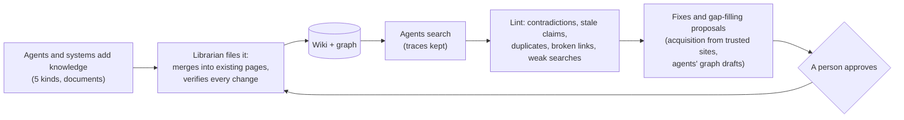
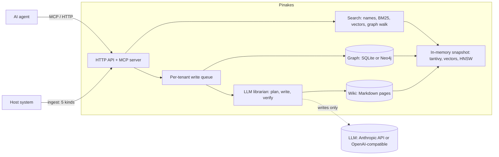

<div align="center">

# Pinakes

**A self-hosted knowledge service for AI agents: a wiki an LLM librarian keeps current, a business graph beside it, and one search entry that answers in milliseconds.**

[](https://github.com/chenkezhen480/pinakes-rs/actions/workflows/ci.yml)
[](#license)


English · [简体中文](README.zh-CN.md)

</div>

Pinakes is named after the catalogue Callimachus wrote for the Library of Alexandria. It works
like a library: the wiki is the collection, and an LLM acts as the **librarian** that files,
merges and checks everything that comes in. It is built around two things.

## 1. Retrieval in milliseconds

The expensive thinking happens once, when knowledge is added (the
[LLM wiki pattern](https://gist.github.com/karpathy/442a6bf555914893e9891c11519de94f)): the
librarian writes the synthesis into pages ahead of time. So a read is only a lookup. **No LLM
and no database query on the read path**: name matching, keyword search, graph walks and, when
the agent asks, a vector search, all over an in-memory snapshot. Classic RAG pays an LLM call on
every question; Pinakes answers before an LLM would have started.

Measured on a laptop with 4 compute threads (medians; method and every number in
[docs/performance.md](docs/performance.md)):

| Wiki size | Keyword search | Vector search | Semantic search, query embedding included | One page changed (write) |
|---|---|---|---|---|
| 10,000 pages | **2.3 ms** | 6 ms (exact) | **20 ms** | 0.16 s |
| 100,000 pages | **10 ms** | **3 to 5 ms** (HNSW, recall@10 0.983) | about 18 to 20 ms (see below) | 1.29 s |

Graph walks take microseconds, and name matching under 0.3 ms at every size. Most of a semantic
search is embedding the query on the CPU: 14 ms with the model's weights in 8 bits, which the
service quantizes itself after the download (same answers on the test set as the full model, at
half the time and memory). At 100,000 pages that adds up to about 18 to 20 ms; the benchmark
measured 38 ms there, while Windows Defender kept two to three cores busy scanning the files it
had just written. What makes it fast:

- **Compiled at write time, looked up at read time**: one search returns answer-shaped pages,
  related memories and real graph edges together, in three slots, with routes to follow.
- **Everything a search touches is in memory**: the tantivy index (memory-mapped), page vectors
  as int8 (a quarter of the memory, compared with AVX2), the graph as adjacency lists.
- **Our own HNSW index** over the int8 vectors of large tenants, one per search slot, updated
  on every write and deletion.
- **Writes change only what changed**: incremental snapshots, so a 100,000-page wiki takes a new
  page in about a second.
- **Rust**, with one bounded compute pool: no garbage-collection pauses, predictable latency.

### Compared end to end through an agent

Pinakes was compared with Mem0, Graphiti, LightRAG and Hindsight end to end through the
[Pi](https://www.npmjs.com/package/@earendil-works/pi-coding-agent) agent: Pi 1.1 with its own MCP client, each system
behind its own read tools, DeepSeek V4.1 Flash as the model of the agent and of every system, the
212 questions of the six-scenario test set (Chinese and English, with users, groups and hidden
graph spaces), each answer graded blind by an LLM judge (2 answered, 1 partly, 0 not).

| System | Search time (median) | Answered fully | Mean score (0–2) | Text handed to the agent per question | Time per question |
|---|---|---|---|---|---|
| **Pinakes** | **3.4 ms** (keywords), 18.9 ms (with meaning) | **99.1%** | **1.99** | 3.4k characters | 3.9 s |
| Hindsight 0.10.3 | 1,911 ms | 95.3% | 1.93 | 31.9k characters | 15.7 s |
| Mem0 2.2.1 | 254 ms | 92.9% | 1.88 | 4.0k characters | 4.3 s |
| Files + grep (Pi's own tools) | – | 92.5% | 1.86 | 3.0k characters | 4.5 s |
| LightRAG 1.5.7 | 1,076 ms | 86.3% | 1.76 | 37.9k characters | 5.7 s |
| Graphiti 0.30.2 | 186 ms | 62.7% | 1.46 | 5.0k characters | 3.9 s |

The other systems embed queries with Qwen3-Embedding-0.6B here (about 120 ms a query on this
CPU); with jina-embeddings-v2-base-zh for every system, as Pinakes uses, they searched in 80 ms
(Graphiti), 106 ms (Mem0) and 854 ms (LightRAG, which calls the LLM on every search). At 10,000
pages Pinakes still answers in 4.3 ms by keywords and 25.5 ms with meaning, while Mem0 took
491 ms and Graphiti 263 ms. No system leaked another user's, group's or hidden space's content.

## 2. Knowledge that hosts and manages itself

**Self-hosted.** Pinakes is one Rust binary, with its web console built in, on your own
machine or server; it reads Word, Excel, PowerPoint, PDF and web pages itself (an optional
converter container adds the old binary Office formats). Your knowledge stays in files you can read: the wiki is plain Markdown, each
tenant has one SQLite file, and graph data sits in SQLite or Neo4j. The embedding model runs
locally. The only outside call is the librarian's model at write time, and that can be any
Anthropic-compatible or OpenAI-compatible endpoint, a local model too (Ollama, vLLM). Tenants,
groups and users are isolated; deletion is hard, checked byte by byte.

**Self-managing.** Nobody has to curate the wiki by hand; people step in only to approve:



- **Filing, not piling up**: new content updates the pages it belongs to instead of adding
  another document; a document is read like a person reads it, one concept at a time, and a new
  version updates only what changed. Edits the evidence doesn't support are held for review.
- **Documents of any length**: the librarian reads a document window by window, as a person
  works through a book, and files each concept as it goes, so a manual of thousands of pages is
  read as fully as a one-page note. The model's context window never limits it; the reading is
  saved after every window, and one that stops resumes where it was (uploads up to 20 MB).
- **Upkeep**: lint finds contradictions, stale claims, duplicates, broken links, unanchored
  memories and keywords searches keep missing, and proposes fixes.
- **Growing on its own**: acquisition reads the sites a tenant trusts (its allowlist only, no
  search engine), matches pages to the gaps lint found, screens them for prompt injection, and
  proposes them; a person approves before anything is filed.
- **Agents take part**: they record experience, decisions and preferences as they work, and
  propose changes to the graph as one reviewable draft per space.

## How it works

Pinakes keeps three layers apart, and only the librarian writes the middle one:

| Layer | What it is | Who writes it |
|---|---|---|
| Raw sources | Task records, decision records, documents, schema definitions, preference notes; kept as they arrived, never changed | The agents and systems that call Pinakes |
| The wiki | Markdown pages per kind and audience, linked to each other and anchored to graph entities | The librarian (an LLM): it plans each change, writes it, and another step verifies it against the sources |
| Graph data | Nodes and edges in graph spaces, checked against their schema | The host system, or agents' drafts once a person approves them; never an LLM |

Knowledge comes in through **one entry per kind**, and goes out through **one search entry**:

| Kind | Added with | Comes back in |
|---|---|---|
| Agent experience: what worked, pitfalls and fixes | `/ingest/experience` | memories |
| User decisions and their outcomes | `/ingest/decision` | memories |
| A decision, a lesson or both, as an agent recorded it (split by the librarian: decisions for the user, lessons for the team) | `/ingest/note`, MCP `record_decision_or_lesson` | memories |
| User preferences | `/ingest/preference`, MCP `record_preference` | memories |
| Vertical expertise: documents and manuals | `/ingest/expertise` (JSON or a file) | knowledge |
| The business graph: schemas, spaces, nodes, edges | `/ingest/graph/schema`, `/space`, `/data` | knowledge (the schema's description) and relations (the edges) |

A search (`/search`, MCP `search`) brings back three slots at once: **memories**, **knowledge**
and **relations**. Each hit says how it matched and carries a route: read the page, open the
source it cites, walk the graph from a node. The service returns signals, not decisions: the
agent chooses keywords or meaning, what to open and what to follow
([A-RAG](https://arxiv.org/abs/2602.03442)), and writes the answer itself.

| | Classic RAG | Pinakes |
|---|---|---|
| When the thinking happens | on every question | once, when knowledge is added |
| What a search finds | raw text chunks | synthesized pages, related memories, real graph edges |
| An LLM on the read path | yes | no |
| Who decides how to search | the pipeline | the agent |
| How knowledge stays current | re-index the documents | the librarian merges, lint checks, people approve |

## Also

- **A business graph described by its schema**: node and relation types, node properties, any
  number of graph spaces (shared, private or restricted).
- **Chinese and English** from day one: jieba tokenizing, a name matcher, and a local
  Chinese–English embedding model for cross-language search.
- **Built for agents**: an MCP server with seven tools whose descriptions teach the retrieval
  strategy, beside the HTTP API.

## Architecture



Reads never call the LLM or query a database: they search the in-memory snapshot. Writes go
through each tenant's queue, where the librarian files them.

## Running modes

Each is one line of `config.toml` (or the compose profile named); the defaults are marked.

| Choice | Options | When |
|---|---|---|
| **Deployment** (`[identity] deployment`) | `multi_tenant` (default) | A platform: an admin creates tenants (`POST /admin/tenants`), each gets an API key; the host sends the user in `X-User-Id`, the groups in `X-User-Groups`, and who a write is for in `X-Audience` |
| | `personal` | One person: the default tenant `000000` is created on first start, its key written to `<data>/personal-api-key.txt`; calls without a user act as `admin` |
| **Identity** (`[identity] mode`) | `api_key` (default) | Calls come from a trusted backend, which names the user |
| | `jwt` | Calls come straight from users' machines (an agent with MCP): the host signs a token holding tenant, user and groups; Pinakes checks it with the host's public key |
| **Graph store** (`[graph] backend`) | `sqlite` (default) | `graph.sqlite` in each tenant's folder: nothing else to run |
| | `neo4j` | The compose profile `neo4j`; move data between the two with `pinakes-migrate-graph` |
| **Meaning search** (`[embedding] enabled`) | off (default) | Keyword search only: nothing is downloaded; `semantic` and `both` say how to turn it on |
| | on (the console's switch, or the config line) | Downloads `jina-embeddings-v2-base-zh` (about 640 MB) into `<data>/models` once, in the background, keeps an 8-bit copy of it (316 MB) in its place, and embeds every page; no restart. `HF_ENDPOINT` names a mirror |
| **Default search mode** (`[search] default_mode`) | `keyword` (default), `semantic`, `both`, `auto` | When a search doesn't say; `auto` tries keywords first and falls back to meaning when coverage is weak |
| **Document conversion** | built in (default) | Markdown, text, HTML, Word (`.docx`), spreadsheets (`.xlsx`, `.csv`), PowerPoint (`.pptx`) and PDF (its text layer, read in a process of its own; a scan is transcribed page by page by the model, which must take images, such as DeepSeek's `deepseek-flash`), read by the service itself |
| | plus MarkItDown (`[converter] url`, compose profile `markitdown`) | The old binary Office formats (`.doc`, `.xls`, `.ppt`); without it they are refused with what to do |
| **Acquisition** (`[acquisition] enabled`) | off (default) | On for the deployment, then per tenant with its allowlist (`PUT /admin/tenants/{id}/acquisition`) |
| **Test chat** (`PINAKES_DEV=1`) | off (default) | The console's Search page gets a chat tab that answers with the read tools an agent has |

How to run it: **Docker Compose** (`docker compose up -d --build` starts the service alone;
add `--profile markitdown` for the old Office formats and `--profile neo4j` for Neo4j), or **from source**
(`cargo run --release`). Either way the **web console** is at `http://127.0.0.1:8080/ui`: search,
the wiki rendered, adding knowledge, the graph drawn, review, lint, acquisition, tenants and
every setting explained, laid out as a 3D hall of the Library of Alexandria whose sky follows
your clock (or as a plain list, a click away). Sign in as `root` with the password `1234` and change it in Settings,
Environment (or set `PINAKES_ADMIN_PASSWORD`) before others can reach the service. The browser
stays signed in until you sign out.
Secrets never go in `config.toml`: `PINAKES_ADMIN_PASSWORD` (the console), `PINAKES_ADMIN_KEY`
(scripts calling the admin routes), `NEO4J_PASSWORD`, and the model's key in `model.conf`
(git-ignored) or the variable it names.

## Quick start

With Docker:

```bash
cp model.conf.example model.conf      # set the librarian's model and key (DeepSeek's Anthropic-compatible endpoint by default)
export PINAKES_ADMIN_KEY=$(openssl rand -hex 24)
export PINAKES_ADMIN_PASSWORD='choose one'   # the console's sign-in as root
docker compose up -d --build          # the console: http://127.0.0.1:8080/ui

# create a tenant and get its API key
curl -s -X POST http://127.0.0.1:8080/admin/tenants \
  -H "Authorization: Bearer $PINAKES_ADMIN_KEY" -H "Content-Type: application/json" \
  -d '{"tenant_id": "acme"}'
```

From source (Rust 1.98 or later):

```bash
cp model.conf.example model.conf
cargo run --release                   # reads config.toml; binds 127.0.0.1:8080
```

From crates.io (the console is built in):

```bash
cargo install pinakes                 # pinakes, pinakes-pdf, pinakes-replay, pinakes-migrate-graph
mkdir pinakes && cd pinakes           # the service keeps its data in ./data
# write model.conf here, as model.conf.example in this repository shows
pinakes                               # without a config.toml it runs on the defaults
```

For one person, set `deployment = "personal"` in `config.toml`: the service creates a default
tenant on first start and writes its key to `<data>/personal-api-key.txt`. To try it with data,
`cargo run --example load_testset -- ./data` loads six sample business scenarios.

### Connect an agent over MCP

Point any MCP client that speaks Streamable HTTP at `http://127.0.0.1:8080/mcp` with the
tenant's key in `Authorization: Bearer <key>` (and the user in `X-User-Id`). The tools:
`search`, `read`, `graph`, `path`, `record_decision_or_lesson`, `record_preference` and
`propose_graph_change`.

### Search over HTTP

```bash
curl -s -X POST http://127.0.0.1:8080/search \
  -H "Authorization: Bearer $KEY" -H "Content-Type: application/json" \
  -d '{"query": "订单1042的下单客户", "keywords": ["订单1042", "下单"]}'
```

## Documentation

- [docs/guide.md](docs/guide.md): how it works and how to use it: concepts, identity, adding
  knowledge, the graph, searching, the librarian, lint and acquisition, storage, the HTTP API
  and the MCP tools.
- [docs/configuration.md](docs/configuration.md): every configuration field.
- [docs/performance.md](docs/performance.md): speed and memory measurements, and how to take them.
- [CONTRIBUTING.md](CONTRIBUTING.md): building, testing and the working rules.
- [CHANGELOG.md](CHANGELOG.md): what each milestone brought.

## Status

Milestones M1 to M10 are built: isolation, search, the graph, the librarian, meaning search,
speed, MCP and packaging, lint and deletion, acquisition and the HNSW index, and the web console
with built-in document conversion and vector search off by default. Pinakes is pre-1.0: APIs may
still change.

## Contributing

Issues and pull requests are welcome; please read [CONTRIBUTING.md](CONTRIBUTING.md) and the
[Code of Conduct](CODE_OF_CONDUCT.md). Report security issues privately, as
[SECURITY.md](SECURITY.md) describes.

## License

Licensed under either of [Apache License, Version 2.0](LICENSE-APACHE) or
[MIT license](LICENSE-MIT) at your option.

Unless you explicitly state otherwise, any contribution intentionally submitted for inclusion
in this project by you, as defined in the Apache-2.0 license, shall be dual licensed as above,
without any additional terms or conditions.

### Third-party components

Besides the Rust crates it is built from, Pinakes downloads or runs beside these components.
None of them is part of this repository; each keeps its own license.

| Component | Used for | How it arrives | License |
|---|---|---|---|
| [jina-embeddings-v2-base-zh](https://huggingface.co/jinaai/jina-embeddings-v2-base-zh) | page and query vectors | downloaded from Hugging Face on first use into `<data>/models` | Apache-2.0 |
| [ONNX Runtime](https://github.com/microsoft/onnxruntime) | running the embedding model | prebuilt library linked into the binary at build time (through `ort`) | MIT |
| [MarkItDown](https://github.com/microsoft/markitdown) | converting old Office files (optional) | the `converter` container image (`markitdown` compose profile) | MIT |
| [Python](https://www.python.org/) | the optional converter's runtime | the `python:3.12-slim` base image | PSF-2.0 |
| [Svelte](https://svelte.dev/) and [d3-force](https://github.com/d3/d3-force) | the web console and its graph layout | compiled into `ui/dist`, embedded in the binary | MIT, ISC |
| [three.js](https://threejs.org/) | the console's 3D hall | compiled into `ui/dist` (its own chunk), embedded in the binary | MIT |
| [jieba](https://github.com/messense/jieba-rs) dictionary | Chinese word segmentation | bundled in the `jieba-rs` crate | MIT |
| [Neo4j Community Edition](https://neo4j.com/) | the optional graph backend | the official `neo4j` image (`neo4j` compose profile) | GPL-3.0 (a separate server, not linked) |
| [Debian](https://www.debian.org/) | the runtime image | the `debian:trixie-slim` base image | various free licenses |

The Rust crates, with their versions in `Cargo.lock`, are all under permissive licenses (MIT,
Apache-2.0, BSD, ISC, Zlib, Unicode-3.0, CDLA-Permissive-2.0, and `option-ext` under MPL-2.0);
`cargo deny` (see `deny.toml`) checks this in CI.
