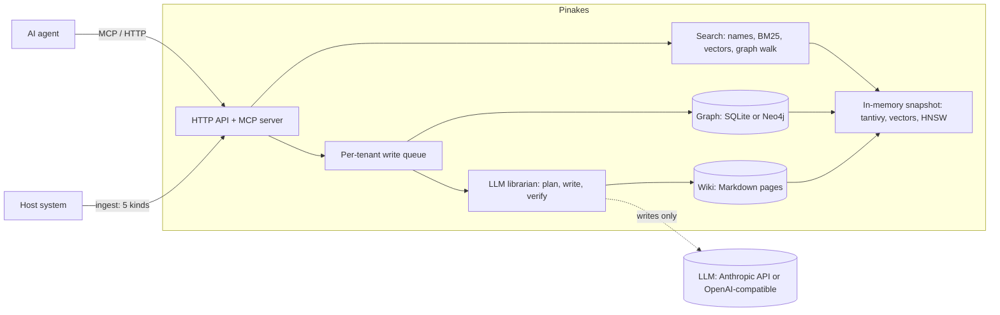

<div align="center">

# Pinakes

**A self-hosted knowledge service for AI agents: a wiki an LLM librarian keeps current, a business graph beside it, and one search entry that answers in milliseconds.**

[](https://github.com/chenkezhen480/pinakes-rs/actions/workflows/ci.yml)
[](#license)


English · [简体中文](README.zh-CN.md)

</div>

Pinakes is named after the catalogue Callimachus wrote for the Library of Alexandria. It works
like a library: the wiki is the collection, and an LLM acts as the **librarian** that files,
merges and checks everything that comes in. The expensive thinking happens once, when content
is added (the [LLM wiki pattern](https://gist.github.com/karpathy/442a6bf555914893e9891c11519de94f)),
so agents read with **no LLM on the read path**: lookups, keyword search, graph walks and, when
the agent asks, a vector search, all over data in memory.

The service returns knowledge, not answers: writing the answer is the calling agent's job.

## Why

Classic RAG searches raw text chunks and asks an LLM to assemble an answer on every question.
Pinakes writes the synthesis into pages ahead of time, so a search returns answer-shaped pages,
related memories and real graph edges together, and the agent decides what to open next
(following [A-RAG](https://arxiv.org/abs/2602.03442)'s agent-driven retrieval).

## Features

- **One search entry, three slots.** `/search` brings back **memories** (agent experience,
  decisions, preferences), **knowledge** (expertise, graph schema descriptions) and
  **relations** (graph edges), each hit with a route for the agent to follow.
- **Five kinds of knowledge, five ways in.** Agent experience, user decision history, vertical
  expertise (documents and manuals), the business graph, and user preferences, each with its own
  rules and page shape. The librarian updates related pages instead of piling up documents, and
  an LLM verifies every change; unsupported edits are held for a person to review.
- **A business graph described by its schema.** Schemas define node and relation types (and the
  properties a node may hold); any number of graph spaces hold real nodes and edges. Graph data
  is stored in SQLite by default, or Neo4j.
- **Chinese and English** from day one: jieba-based tokenizing, a name matcher over page and node
  names, and a local Chinese–English embedding model (`jina-embeddings-v2-base-zh`) for
  cross-language meaning search.
- **Isolation by tenant, group and user**, on pages and graph spaces alike (shared, private or
  restricted). Identity comes from the host system: API keys or JWT.
- **Built for agents**: an MCP server with eight tools whose descriptions teach the retrieval
  strategy, beside the HTTP API.
- **Self-maintaining**: lint finds contradictions, stale claims, duplicates, broken links and
  frequent weak searches; acquisition can then propose pages from sites the tenant trusts
  (read only from its allowlist, screened for prompt injection, filed only after a person
  approves). Agents may propose graph changes too, held for review.
- **Fast at scale**: an HNSW index of our own over int8 page vectors for large tenants.

## Performance

Measured on a laptop with 4 compute threads (median, see [docs/design.md](docs/design.md)
"How it stays fast"):

| Wiki size | Keyword search | Semantic search (with the query embedding) | One page changed (write) |
|---|---|---|---|
| 10,000 pages | 2.3 ms | about 37 ms | 0.16 s |
| 100,000 pages | 10 ms | about 33 ms (HNSW; recall@10 0.983 on real vectors) | 1.29 s |

Embedding the query takes most of a semantic search (about 29 ms on CPU); the vector search
itself takes 3 to 5 ms at 100,000 pages.

## Architecture



Reads never call the LLM or query a database: they search the in-memory snapshot. Writes go
through each tenant's queue, where the librarian files them.

## Quick start

With Docker (the service, plus the document converter):

```bash
cp model.conf.example model.conf      # set the librarian's model and key (DeepSeek's Anthropic-compatible endpoint by default)
export PINAKES_ADMIN_KEY=$(openssl rand -hex 24)
docker compose up -d --build          # serves on http://127.0.0.1:8080

# create a tenant and get its API key
curl -s -X POST http://127.0.0.1:8080/admin/tenants \
  -H "Authorization: Bearer $PINAKES_ADMIN_KEY" -H "Content-Type: application/json" \
  -d '{"tenant_id": "acme"}'
```

From source (Rust 1.98 or later):

```bash
cp model.conf.example model.conf
cargo run --release                   # reads config.toml; binds 127.0.0.1:8080
```

For one person, set `deployment = "personal"` in `config.toml`: the service creates a default
tenant on first start and writes its key to `<data>/personal-api-key.txt`. To try it with data,
`cargo run --example load_testset -- ./data` loads six sample business scenarios.

### Connect an agent over MCP

Point any MCP client that speaks Streamable HTTP at `http://127.0.0.1:8080/mcp` with the
tenant's key in `Authorization: Bearer <key>` (and the user in `X-User-Id`). The tools:
`search`, `read`, `graph`, `path`, `record_experience`, `record_decision`, `record_preference`
and `propose_graph_change`.

### Search over HTTP

```bash
curl -s -X POST http://127.0.0.1:8080/search \
  -H "Authorization: Bearer $KEY" -H "Content-Type: application/json" \
  -d '{"query": "订单1042的下单客户", "keywords": ["订单1042", "下单"]}'
```

## Documentation

- [docs/design.md](docs/design.md): the full design, with what was built in each milestone,
  measurements and decisions (English).
- [CONTRIBUTING.md](CONTRIBUTING.md): building, testing and the working rules.
- [CHANGELOG.md](CHANGELOG.md): what each milestone brought.

## Status

Milestones M1 to M9 are built: isolation, search, the graph, the librarian, meaning search,
speed, MCP and packaging, lint and deletion, acquisition and the HNSW index. **M10** is planned:
a web console for every operation, built-in document conversion (the MarkItDown container
becoming optional) and vector search off by default. Pinakes is pre-1.0: APIs may still change.

## Contributing

Issues and pull requests are welcome; please read [CONTRIBUTING.md](CONTRIBUTING.md) and the
[Code of Conduct](CODE_OF_CONDUCT.md). Report security issues privately, as
[SECURITY.md](SECURITY.md) describes.

## License

Licensed under either of [Apache License, Version 2.0](LICENSE-APACHE) or
[MIT license](LICENSE-MIT) at your option.

Unless you explicitly state otherwise, any contribution intentionally submitted for inclusion
in this project by you, as defined in the Apache-2.0 license, shall be dual licensed as above,
without any additional terms or conditions.

### Third-party components

Besides the Rust crates it is built from, Pinakes downloads or runs beside these components.
None of them is part of this repository; each keeps its own license.

| Component | Used for | How it arrives | License |
|---|---|---|---|
| [jina-embeddings-v2-base-zh](https://huggingface.co/jinaai/jina-embeddings-v2-base-zh) | page and query vectors | downloaded from Hugging Face on first use into `<data>/models` | Apache-2.0 |
| [ONNX Runtime](https://github.com/microsoft/onnxruntime) | running the embedding model | prebuilt library linked into the binary at build time (through `ort`) | MIT |
| [MarkItDown](https://github.com/microsoft/markitdown) | converting uploaded files to Markdown | the `converter` container image | MIT |
| [Python](https://www.python.org/) | the converter's runtime | the `python:3.12-slim` base image | PSF-2.0 |
| [jieba](https://github.com/messense/jieba-rs) dictionary | Chinese word segmentation | bundled in the `jieba-rs` crate | MIT |
| [Neo4j Community Edition](https://neo4j.com/) | the optional graph backend | the official `neo4j` image (`neo4j` compose profile) | GPL-3.0 (a separate server, not linked) |
| [Debian](https://www.debian.org/) | the runtime image | the `debian:trixie-slim` base image | various free licenses |

The Rust crates, with their versions in `Cargo.lock`, are all under permissive licenses (MIT,
Apache-2.0, BSD, ISC, Zlib, Unicode-3.0, CDLA-Permissive-2.0, and `option-ext` under MPL-2.0);
`cargo deny` (see `deny.toml`) checks this in CI.
