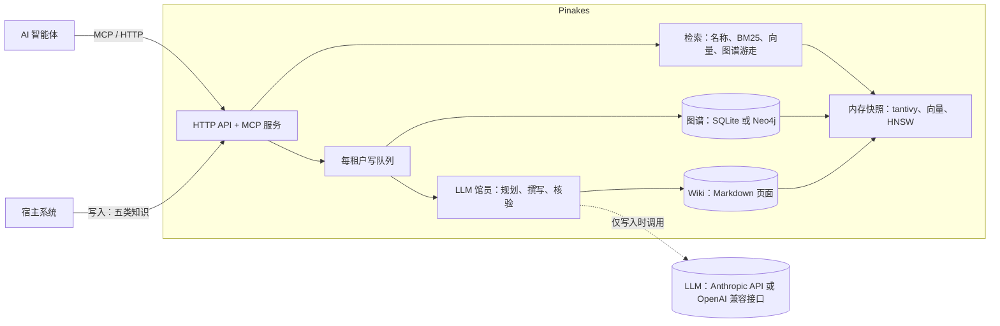

<div align="center">

# Pinakes

**为 AI 智能体打造的自托管知识服务：由 LLM「馆员」持续维护的 Wiki、与之并列的业务图谱，以及一个毫秒级返回的统一检索入口。**

[](https://github.com/chenkezhen480/pinakes-rs/actions/workflows/ci.yml)
[](#许可证)


[English](README.md) · 简体中文

</div>

Pinakes 得名于卡利马科斯为亚历山大图书馆编写的书目。它的工作方式就像一座图书馆：Wiki 是馆藏，
LLM 担任**馆员**，负责归档、合并和核查每一份进来的内容。昂贵的思考只在写入时发生一次
（[LLM Wiki 模式](https://gist.github.com/karpathy/442a6bf555914893e9891c11519de94f)），
因此智能体读取时**完全不调用 LLM**：名称查找、关键词检索、图谱游走，以及智能体需要时的向量检索，
全部在内存数据上完成。

服务返回的是知识，而不是答案：组织答案是调用方智能体的工作。

## 为什么

传统 RAG 检索原始文本片段，每个问题都要让 LLM 临时拼出答案。Pinakes 提前把综合结论写进页面，
一次检索就能同时拿到“答案形态”的页面、相关记忆和真实的图谱边，再由智能体决定下一步打开什么
（遵循 [A-RAG](https://arxiv.org/abs/2602.03442) 的智能体自主检索思路）。

## 功能

- **一个检索入口，三个结果槽。** `/search` 同时返回**记忆**（智能体经验、用户决策、偏好）、
  **知识**（专业知识、图谱 schema 说明）和**关系**（图谱的边），每条结果都附带可继续跟进的路径。
- **五类知识，五个写入口。** 智能体经验、用户决策历史、垂直领域专业知识（文档与手册）、业务图谱、
  用户偏好，各有自己的规则和页面形态。馆员会更新相关页面而不是堆积文档，每次修改都经 LLM 核验；
  证据不足的修改会暂存，交由人工审核。
- **由 schema 描述的业务图谱。** schema 定义节点类型、关系类型以及节点可携带的属性；一个 schema
  可以支撑任意多个图空间，存放真实的节点和边。图数据默认存于 SQLite，也可选用 Neo4j。
- **中英双语原生支持**：基于 jieba 的分词、覆盖页面名与节点名的名称匹配器，以及本地运行的中英文
  向量模型（`jina-embeddings-v2-base-zh`），支持跨语言语义检索。
- **按租户、组、用户隔离**，Wiki 页面和图空间（共享、私有、受限）遵循同一套规则。身份来自宿主系统：
  API Key 或 JWT。
- **为智能体而建**：除 HTTP API 外提供 MCP 服务，8 个工具的描述本身就教会智能体检索策略。
- **自我维护**：lint 发现矛盾、过时说法、重复页面、坏链接和高频弱检索；外部获取可以从租户信任的
  站点中为缺口提议新内容（只读白名单站点，经过提示注入审查，人工批准后才入库）。智能体也可以提议
  修改图谱，同样等待审核。
- **大规模下依然快**：为大租户自研的 HNSW 索引，建立在 int8 页面向量之上。

## 性能

在一台笔记本上以 4 个计算线程测得（中位数，详见 [docs/design.md](docs/design.md)
“How it stays fast”）：

| Wiki 规模 | 关键词检索 | 语义检索（含查询向量化） | 修改一页（写入） |
|---|---|---|---|
| 1 万页 | 2.3 ms | 约 37 ms | 0.16 s |
| 10 万页 | 10 ms | 约 33 ms（HNSW；真实向量上 recall@10 为 0.983） | 1.29 s |

语义检索的大部分时间花在查询向量化（CPU 上约 29 ms）；10 万页时向量检索本身只需 3 到 5 ms。

## 架构



读取从不调用 LLM，也不查询数据库，只检索内存快照；写入经由各租户的队列，由馆员完成归档。

## 快速开始

使用 Docker（服务本体加文档转换器）：

```bash
cp model.conf.example model.conf      # 配置馆员使用的模型和密钥（默认是 DeepSeek 的 Anthropic 兼容接口）
export PINAKES_ADMIN_KEY=$(openssl rand -hex 24)
docker compose up -d --build          # 服务地址 http://127.0.0.1:8080

# 创建租户并取得它的 API Key
curl -s -X POST http://127.0.0.1:8080/admin/tenants \
  -H "Authorization: Bearer $PINAKES_ADMIN_KEY" -H "Content-Type: application/json" \
  -d '{"tenant_id": "acme"}'
```

从源码运行（Rust 1.98 及以上）：

```bash
cp model.conf.example model.conf
cargo run --release                   # 读取 config.toml，监听 127.0.0.1:8080
```

个人使用时，在 `config.toml` 中设置 `deployment = "personal"`：首次启动会自动创建默认租户，
并把它的 Key 写入 `<data>/personal-api-key.txt`。想带数据试用，运行
`cargo run --example load_testset -- ./data`，会载入六个示例业务场景。

### 通过 MCP 接入智能体

任何支持 Streamable HTTP 的 MCP 客户端，指向 `http://127.0.0.1:8080/mcp`，并在
`Authorization: Bearer <key>` 中带上租户的 Key（用户放在 `X-User-Id`）。可用工具：
`search`、`read`、`graph`、`path`、`record_experience`、`record_decision`、`record_preference`
和 `propose_graph_change`。

### 通过 HTTP 检索

```bash
curl -s -X POST http://127.0.0.1:8080/search \
  -H "Authorization: Bearer $KEY" -H "Content-Type: application/json" \
  -d '{"query": "订单1042的下单客户", "keywords": ["订单1042", "下单"]}'
```

## 文档

- [docs/design.md](docs/design.md)：完整设计，包括每个里程碑实际做了什么、测量数据和各项决策（英文）。
- [CONTRIBUTING.md](CONTRIBUTING.md)：构建、测试与协作规范。
- [CHANGELOG.md](CHANGELOG.md)：各里程碑带来的变化。

## 项目状态

里程碑 M1 至 M9 已完成：隔离、检索、图谱、馆员、语义检索、性能、MCP 与打包、lint 与删除、外部获取
以及 HNSW 索引。**M10** 已规划：覆盖全部操作的网页控制台、内置文档转换（MarkItDown 容器改为可选）、
向量检索默认关闭。Pinakes 尚处于 1.0 之前，API 仍可能变化。

## 参与贡献

欢迎提交 Issue 和 Pull Request；请先阅读 [CONTRIBUTING.md](CONTRIBUTING.md) 和
[行为准则](CODE_OF_CONDUCT.md)。安全问题请按 [SECURITY.md](SECURITY.md) 私下报告。

## 许可证

可任选 [Apache License 2.0](LICENSE-APACHE) 或 [MIT 许可证](LICENSE-MIT) 之一使用。

除非你另有明确声明，你有意提交并被纳入本项目的任何贡献（按 Apache-2.0 许可证的定义），
均按上述双许可方式授权，不附加任何其他条款或条件。

### 第三方组件

除了构建所用的 Rust crate，Pinakes 还会下载或在旁运行以下组件。它们都不属于本仓库，各自遵循自己的许可证。

| 组件 | 用途 | 获取方式 | 许可证 |
|---|---|---|---|
| [jina-embeddings-v2-base-zh](https://huggingface.co/jinaai/jina-embeddings-v2-base-zh) | 页面与查询的向量 | 首次使用时从 Hugging Face 下载到 `<data>/models` | Apache-2.0 |
| [ONNX Runtime](https://github.com/microsoft/onnxruntime) | 运行向量模型 | 构建时通过 `ort` 链接进程序的预编译库 | MIT |
| [MarkItDown](https://github.com/microsoft/markitdown) | 把上传文件转成 Markdown | `converter` 容器镜像 | MIT |
| [Python](https://www.python.org/) | 转换器的运行环境 | `python:3.12-slim` 基础镜像 | PSF-2.0 |
| [jieba](https://github.com/messense/jieba-rs) 词典 | 中文分词 | 随 `jieba-rs` crate 一起分发 | MIT |
| [Neo4j 社区版](https://neo4j.com/) | 可选的图存储 | 官方 `neo4j` 镜像（compose 的 `neo4j` profile） | GPL-3.0（独立服务，不链接） |
| [Debian](https://www.debian.org/) | 运行镜像 | `debian:trixie-slim` 基础镜像 | 多种自由软件许可证 |

Rust crate 及其版本见 `Cargo.lock`，全部为宽松许可证（MIT、Apache-2.0、BSD、ISC、Zlib、Unicode-3.0、
CDLA-Permissive-2.0，以及 MPL-2.0 的 `option-ext`），CI 中由 `cargo deny`（见 `deny.toml`）检查。
