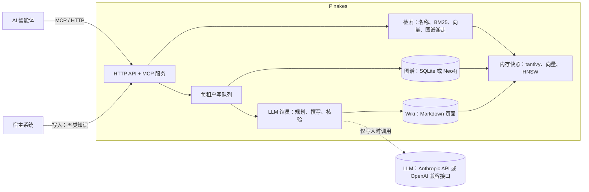

<div align="center">

# Pinakes

**为 AI 智能体打造的自托管知识服务：由 LLM「馆员」持续维护的 Wiki、与之并列的业务图谱，以及一个毫秒级返回的统一检索入口。**

[](https://github.com/chenkezhen480/pinakes-rs/actions/workflows/ci.yml)
[](#许可证)


[English](README.md) · 简体中文

</div>

Pinakes 得名于卡利马科斯为亚历山大图书馆编写的书目。它的工作方式就像一座图书馆：Wiki 是馆藏，
LLM 担任**馆员**，负责归档、合并和核查每一份进来的内容。它围绕两件事打造。

## 一、毫秒级检索

昂贵的思考只在知识写入时发生一次（[LLM Wiki 模式](https://gist.github.com/karpathy/442a6bf555914893e9891c11519de94f)）：
馆员提前把综合结论写进页面，读取就只剩查找。**读取路径上不调用生成式模型，也不查询数据库**：名称匹配、
关键词检索、图谱游走，以及智能体需要时的向量检索（只用到一个小的查询编码模型），全部在内存快照上完成。
传统 RAG 的检索本身也很快，但它返回的是原始文本片段，每个问题都要再由 LLM 综合一遍；Pinakes 的综合在写入时
就已经写进了页面，智能体直接依据页面作答。

在一台笔记本上以 4 个计算线程测得（中位数；方法与全部数据见 [docs/performance.md](docs/performance.md)）：

| Wiki 规模 | 关键词检索 | 向量检索 | 语义检索（含查询向量化） | 修改一页（写入） |
|---|---|---|---|---|
| 1 万页 | **2.3 ms** | 6 ms（精确比对） | **20 ms** | 0.16 s |
| 10 万页 | **13.3 ms**¹ | **约 3 ms**（HNSW） | 37.6 ms¹ | 1.29 s |

¹ 测量时 Windows Defender 正用两三个核扫描基准测试刚写入的文件；多次运行中关键词检索为 10 到 13 ms。
按单独测得的查询向量化时间（14 到 16 ms）估算，空闲机器上的语义检索约 18 到 20 ms，这是估算值，不是实测。

基准测试里的页面向量是模拟向量，所以这两行衡量的是速度，不是检索质量。检索质量另外用服务的 8 位模型生成的
真实向量测过：HNSW 索引与精确比对的结果一致，在 10,881 条向量（3,093 页）上 recall@10 为 0.993。
图谱游走在微秒级，名称匹配在任何规模下都低于 0.3 ms。语义检索的大部分时间花在用 CPU 计算查询向量：
模型权重由服务在下载后自行量化为 8 位，只需 14 ms（测试集上答案与原模型相同，时间和内存减半）。快的原因：

- **写入时编译，读取时查表**：一次检索同时返回“答案形态”的页面、相关记忆和真实的图谱边，分在三个结果槽里，
  并附带可继续跟进的路径。
- **检索涉及的一切都在内存中**：tantivy 索引（内存映射）、int8 量化的页面向量（内存只需四分之一，
  用 AVX2 比对）、以邻接表存放的图谱。
- **自研 HNSW 索引**：为大租户的 int8 向量建立，每个结果槽一份，随每次写入和删除同步更新。
- **写入只改变化的部分**：增量快照，10 万页的 Wiki 写入一页约 1 秒。
- **Rust 实现**，配一个有上限的计算线程池：没有垃圾回收停顿，延迟可预期。

### 经智能体端到端对比

我们通过 [Pi](https://www.npmjs.com/package/@earendil-works/pi-coding-agent) 智能体，把 Pinakes 与 Mem0、Graphiti、
LightRAG、Hindsight 做了端到端对比：Pi 1.1 用自带的 MCP 客户端，各系统只提供各自的读取工具；智能体和各系统
都使用 DeepSeek V4.1 Flash；题目是测试集六个场景的 212 道题（中英文，包含多用户、群组和隐藏的图谱空间）；
每个回答由 LLM 评审在不知道是哪个系统的情况下打分（2 答全，1 部分答对，0 未答对）。

| 系统 | 检索耗时（中位数） | 完整答对 | 平均分（0–2） | 每题交给智能体的文本 | 每题耗时 |
|---|---|---|---|---|---|
| **Pinakes** | **3.4 ms**（关键词），18.9 ms（含语义） | **99.1%** | **1.99** | 3.4k 字符 | 3.9 s |
| Hindsight 0.10.3 | 1,911 ms | 95.3% | 1.93 | 31.9k 字符 | 15.7 s |
| Mem0 2.2.1 | 254 ms | 92.9% | 1.88 | 4.0k 字符 | 4.3 s |
| 文件 + grep（Pi 自带工具） | – | 92.5% | 1.86 | 3.0k 字符 | 4.5 s |
| LightRAG 1.5.7 | 1,076 ms | 86.3% | 1.76 | 37.9k 字符 | 5.7 s |
| Graphiti 0.30.2 | 186 ms | 62.7% | 1.46 | 5.0k 字符 | 3.9 s |

表中其他系统用 Qwen3-Embedding-0.6B 向量化查询（在这台机器的 CPU 上每次约 120 ms）；如果都换成 Pinakes 所用的
jina-embeddings-v2-base-zh，它们的检索耗时分别是 80 ms（Graphiti）、106 ms（Mem0）和 854 ms（LightRAG，每次检索
都要调用 LLM）。扩大到 10,000 页时，Pinakes 关键词检索仍是 4.3 ms、语义检索 25.5 ms，而 Mem0 增至 491 ms、
Graphiti 增至 263 ms。所有系统都没有泄露其他用户、群组或隐藏空间的内容。

## 二、知识自托管、自管理

**自托管。** Pinakes 是一个内置网页控制台的 Rust 程序，运行在你自己的机器或服务器上；它自己就能读取 Word、Excel、PowerPoint、PDF 和网页（可选的转换容器再加上旧版二进制 Office 格式）。
知识保存在你看得懂的文件里：Wiki 是纯 Markdown，每个租户一个 SQLite 文件，图数据存于 SQLite 或 Neo4j。
向量模型在本地运行。唯一的外部调用是写入时馆员所用的模型，可以是任何 Anthropic 兼容或 OpenAI 兼容的接口，
本地模型（Ollama、vLLM）也可以。租户、组、用户彼此隔离；删除是彻底删除，测试逐字节核查。

**自管理。** 不需要有人手工整理 Wiki，人只在审批时介入：


- **归档而不是堆积**：新内容会更新它所属的页面，而不是再加一份文档；文档像人一样逐个概念地读，新版本只更新
  改动的部分。证据不足的修改会暂存待审。
- **再大的文档也能读完**：馆员像人读书一样一个窗口接一个窗口地往下读，读到一个概念就归档一个，几千页的手册
  和一页纸的笔记一样能读完、读全。文档长度不受模型上下文窗口限制；每读完一个窗口都会保存进度，中断后从原处
  接着读（单个上传文件最大 20 MB）。
- **日常维护**：lint 发现矛盾、过时说法、重复页面、坏链接、没有锚点的记忆，以及总是检索不到的关键词，
  并提出修复。
- **自己生长**：外部获取只读取租户信任的站点（白名单，不用搜索引擎），把页面与 lint 找到的缺口匹配，
  审查提示注入后提出建议；人工批准后才会入库。
- **智能体参与其中**：它们在工作中记录经验、决策和偏好，并以每个图空间一份可审阅草稿的方式提议修改图谱。

## 基本思路

Pinakes 把知识分成三层，中间那层只由馆员来写：

| 层 | 是什么 | 由谁写 |
|---|---|---|
| 原始资料 | 任务记录、决策记录、文档、schema 定义、偏好记录；按原样保存，从不修改 | 调用 Pinakes 的智能体和系统 |
| Wiki | 按知识类型和可见范围组织的 Markdown 页面，彼此链接，并锚定到图谱实体 | 馆员（LLM）：先规划修改、再撰写，另有一步对照原始资料核验 |
| 图数据 | 图空间里的节点和边，按其 schema 校验 | 宿主系统，或经人工批准的智能体草稿；从不由 LLM 写入 |

知识从**每类一个写入口**进来，从**唯一的检索入口**出去：

| 知识类型 | 写入方式 | 出现在 |
|---|---|---|
| 智能体经验：有效做法、踩过的坑与解决办法 | `/ingest/experience` | 记忆 |
| 用户决策及其结果 | `/ingest/decision` | 记忆 |
| 智能体记下的决定、教训或两者（由整理员拆分：决定归用户本人，教训归团队） | `/ingest/note`，MCP `record_decision_or_lesson` | 记忆 |
| 用户偏好 | `/ingest/preference`，MCP `record_preference` | 记忆 |
| 垂直领域专业知识：文档与手册 | `/ingest/expertise`（JSON 或文件） | 知识 |
| 业务图谱：schema、图空间、节点、边 | `/ingest/graph/schema`、`/space`、`/data` | 知识（schema 说明）与关系（边） |

一次检索（`/search`，MCP `search`）同时返回三个结果槽：**记忆**、**知识**和**关系**。每条结果都说明它是怎么
匹配上的，并附带一条可跟进的路径：阅读页面、打开它引用的原始资料、从某个节点游走图谱。服务只提供信号，不替智能体
做决定：用关键词还是语义、打开什么、跟进什么，都由智能体自己决定（[A-RAG](https://arxiv.org/abs/2602.03442)），
答案也由它自己组织。

| | 传统 RAG | Pinakes |
|---|---|---|
| 什么时候“思考” | 每个问题都要 | 知识写入时一次 |
| 检索到的是什么 | 原始文本片段 | 整理好的页面、相关记忆、真实的图谱边 |
| 每个问题的模型工作 | 由 LLM 综合检索到的片段 | 智能体依据已综合好的页面作答；检索本身不调用生成式模型 |
| 谁决定怎么检索 | 固定流程 | 智能体 |
| 知识怎么保持最新 | 重新索引文档 | 馆员合并、lint 检查、人工审批 |

## 其他

- **由 schema 描述的业务图谱**：节点类型、关系类型、节点属性，任意多个图空间（共享、私有或受限）。
- **中英双语原生支持**：jieba 分词、名称匹配器，以及本地运行的中英文向量模型，支持跨语言检索。
- **为智能体而建**：除 HTTP API 外提供 MCP 服务，7 个工具的描述本身就教会智能体检索策略。

## 架构



读取从不调用 LLM，也不查询数据库，只检索内存快照；写入经由各租户的队列，由馆员完成归档。

## 运行模式

每一项都是 `config.toml` 里的一行（或对应的 compose profile）；标注了默认值。

| 选项 | 取值 | 适用场景 |
|---|---|---|
| **部署形态**（`[identity] deployment`） | `multi_tenant`（默认） | 平台：管理员创建租户（`POST /admin/tenants`），每个租户得到一个 API Key；宿主在 `X-User-Id` 里传用户、`X-User-Groups` 里传组、`X-Audience` 里说明写入归属 |
| | `personal` | 个人使用：首次启动自动创建默认租户 `000000`，Key 写入 `<data>/personal-api-key.txt`；不带用户的请求视为 `admin` |
| **身份方式**（`[identity] mode`） | `api_key`（默认） | 请求来自可信的后端，由它指明用户 |
| | `jwt` | 请求直接来自用户的机器（例如接了 MCP 的智能体）：宿主签发包含租户、用户、组的 token，Pinakes 用宿主的公钥验签 |
| **图存储**（`[graph] backend`） | `sqlite`（默认） | 每个租户目录下一个 `graph.sqlite`，无需额外服务 |
| | `neo4j` | 使用 compose 的 `neo4j` profile；两者之间用 `pinakes-migrate-graph` 迁移数据 |
| **语义检索**（`[embedding] enabled`） | 关闭（默认） | 只用关键词检索，不下载任何东西；`semantic` 会说明如何开启，`auto` 只用关键词 |
| | 开启（控制台开关或配置行） | 在后台一次性下载 `jina-embeddings-v2-base-zh`（约 640 MB）到 `<data>/models`，只保留由它生成的 8 位版本（316 MB），并嵌入所有页面，无需重启；可用 `HF_ENDPOINT` 指定镜像 |
| **默认检索模式**（`[search] default_mode`） | `auto`（默认）、`keyword`、`semantic` | 检索请求未指定时使用；`auto` 在开启向量时同时按关键词和语义检索，关闭时只用关键词 |
| **文档转换** | 内置（默认） | Markdown、文本、HTML、Word（`.docx`）、表格（`.xlsx`、`.csv`）、PowerPoint（`.pptx`）和 PDF（读取文字层，在单独进程中进行；扫描件由模型逐页转写，模型须能接收图片，如 DeepSeek 的 `deepseek-flash`）由服务自行读取 |
| | 加上 MarkItDown（`[converter] url`，compose profile `markitdown`） | 旧版二进制 Office（`.doc`、`.xls`、`.ppt`）；没有它时会拒绝并说明怎么办 |
| **外部获取**（`[acquisition] enabled`） | 关闭（默认） | 先在部署层面打开，再按租户配置白名单开启（`PUT /admin/tenants/{id}/acquisition`） |
| **测试聊天**（`PINAKES_DEV=1`） | 关闭（默认） | 控制台检索页多出一个对话分页，用智能体同样的读取工具作答 |

运行方式：**Docker Compose**（`docker compose up -d --build` 只启动服务本体；需要旧版 Office 格式时加
`--profile markitdown`，需要 Neo4j 时加 `--profile neo4j`），或**从源码运行**（`cargo run --release`）。
两种方式下**网页控制台**都在 `http://127.0.0.1:8080/ui`：检索、渲染后的知识库、录入知识、画出来的图谱、
审阅、体检、采集、租户，以及逐项说明的全部设置；界面是一座 3D 的亚历山大图书馆大厅，窗外天色随时间变化（也可一键切换为列表）。用户名 `root`、密码 `1234` 登录，
在别人能访问到服务之前，到 设置 → 环境 修改（或设置 `PINAKES_ADMIN_PASSWORD`）。
登录状态保存在浏览器里，直到退出。密钥从不写进 `config.toml`：`PINAKES_ADMIN_PASSWORD`（控制台）、
`PINAKES_ADMIN_KEY`（脚本调用管理接口）、`NEO4J_PASSWORD`，以及写在 `model.conf`（不进 git）或它所指定环境变量里的模型密钥。

## 快速开始

使用 Docker：

```bash
cp model.conf.example model.conf      # 配置馆员使用的模型和密钥（默认是 DeepSeek 的 Anthropic 兼容接口）
export PINAKES_ADMIN_KEY=$(openssl rand -hex 24)
export PINAKES_ADMIN_PASSWORD='自己定一个'   # 控制台以 root 登录的密码
docker compose up -d --build          # 控制台 http://127.0.0.1:8080/ui

# 创建租户并取得它的 API Key
curl -s -X POST http://127.0.0.1:8080/admin/tenants \
  -H "Authorization: Bearer $PINAKES_ADMIN_KEY" -H "Content-Type: application/json" \
  -d '{"tenant_id": "acme"}'
```

从源码运行（Rust 1.98 及以上）：

```bash
cp model.conf.example model.conf
cargo run --release                   # 读取 config.toml，监听 127.0.0.1:8080
```

从 crates.io 安装（控制台已内置）：

```bash
cargo install pinakes                 # 安装 pinakes、pinakes-pdf、pinakes-replay、pinakes-migrate-graph
mkdir pinakes && cd pinakes           # 数据保存在 ./data
# 在这里写好 model.conf，格式见本仓库的 model.conf.example
pinakes                               # 没有 config.toml 时使用默认配置
```

个人使用时，在 `config.toml` 中设置 `deployment = "personal"`：首次启动会自动创建默认租户，
并把它的 Key 写入 `<data>/personal-api-key.txt`。想带数据试用，运行
`cargo run --example load_testset -- ./data`，会载入六个示例业务场景。

### 通过 MCP 接入智能体

任何支持 Streamable HTTP 的 MCP 客户端，指向 `http://127.0.0.1:8080/mcp`，并在
`Authorization: Bearer <key>` 中带上租户的 Key（用户放在 `X-User-Id`）。可用工具：
`search`、`read`、`graph`、`path`、`record_decision_or_lesson`、`record_preference` 和
`propose_graph_change`。

### 通过 HTTP 检索

```bash
curl -s -X POST http://127.0.0.1:8080/search \
  -H "Authorization: Bearer $KEY" -H "Content-Type: application/json" \
  -d '{"query": "订单1042的下单客户", "keywords": ["订单1042", "下单"]}'
```

## 文档

- [docs/guide.md](docs/guide.md)：工作原理与用法：概念、身份、写入知识、图谱、检索、馆员、lint 与外部获取、存储、HTTP API 和 MCP 工具（英文）。
- [docs/configuration.md](docs/configuration.md)：全部配置项（英文）。
- [docs/performance.md](docs/performance.md)：速度与内存的测量数据及测量方法（英文）。
- [CONTRIBUTING.md](CONTRIBUTING.md)：构建、测试与协作规范。
- [CHANGELOG.md](CHANGELOG.md)：各里程碑带来的变化。

## 项目状态

里程碑 M1 至 M10 已完成：隔离、检索、图谱、馆员、语义检索、性能、MCP 与打包、lint 与删除、外部获取
以及 HNSW 索引，还有网页控制台、内置文档转换和默认关闭的向量检索。Pinakes 尚处于 1.0 之前，API 仍可能变化。

## 参与贡献

欢迎提交 Issue 和 Pull Request；请先阅读 [CONTRIBUTING.md](CONTRIBUTING.md) 和
[行为准则](CODE_OF_CONDUCT.md)。安全问题请按 [SECURITY.md](SECURITY.md) 私下报告。

## 许可证

可任选 [Apache License 2.0](LICENSE-APACHE) 或 [MIT 许可证](LICENSE-MIT) 之一使用。

除非你另有明确声明，你有意提交并被纳入本项目的任何贡献（按 Apache-2.0 许可证的定义），
均按上述双许可方式授权，不附加任何其他条款或条件。

### 第三方组件

除了构建所用的 Rust crate，Pinakes 还会下载或在旁运行以下组件。它们都不属于本仓库，各自遵循自己的许可证。

| 组件 | 用途 | 获取方式 | 许可证 |
|---|---|---|---|
| [jina-embeddings-v2-base-zh](https://huggingface.co/jinaai/jina-embeddings-v2-base-zh) | 页面与查询的向量 | 首次使用时从 Hugging Face 下载到 `<data>/models` | Apache-2.0 |
| [ONNX Runtime](https://github.com/microsoft/onnxruntime) | 运行向量模型 | 构建时通过 `ort` 链接进程序的预编译库 | MIT |
| [MarkItDown](https://github.com/microsoft/markitdown) | 转换旧版 Office 文件（可选） | `converter` 容器镜像（compose profile `markitdown`） | MIT |
| [Python](https://www.python.org/) | 可选转换器的运行环境 | `python:3.12-slim` 基础镜像 | PSF-2.0 |
| [Svelte](https://svelte.dev/) 与 [d3-force](https://github.com/d3/d3-force) | 网页控制台及其图谱布局 | 编译进 `ui/dist`，嵌入程序 | MIT、ISC |
| [three.js](https://threejs.org/) | 控制台的 3D 大厅 | 编译进 `ui/dist`（单独分块），嵌入程序 | MIT |
| [jieba](https://github.com/messense/jieba-rs) 词典 | 中文分词 | 随 `jieba-rs` crate 一起分发 | MIT |
| [Neo4j 社区版](https://neo4j.com/) | 可选的图存储 | 官方 `neo4j` 镜像（compose 的 `neo4j` profile） | GPL-3.0（独立服务，不链接） |
| [Debian](https://www.debian.org/) | 运行镜像 | `debian:trixie-slim` 基础镜像 | 多种自由软件许可证 |

Rust crate 及其版本见 `Cargo.lock`，全部为宽松许可证（MIT、Apache-2.0、BSD、ISC、Zlib、Unicode-3.0、
CDLA-Permissive-2.0，以及 MPL-2.0 的 `option-ext`），CI 中由 `cargo deny`（见 `deny.toml`）检查。
