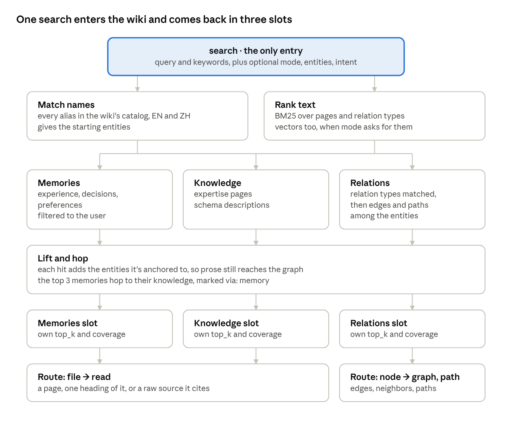
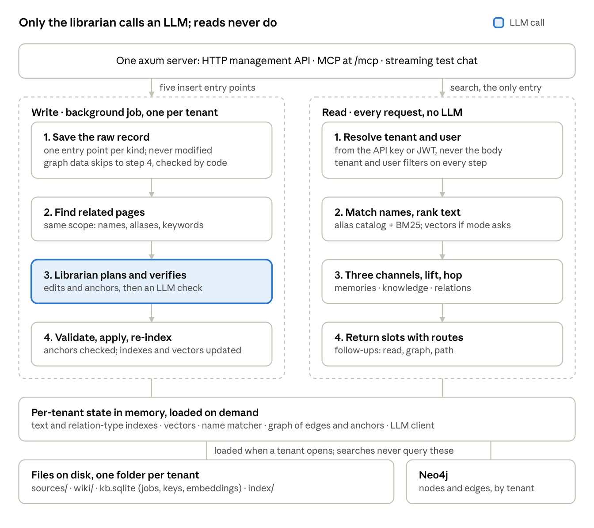

# Pinakes: Knowledge Base Service in Rust — Design

Sep 29, 2026 · @Banks Jorge

## What we're building

We're building an open-source, self-hosted knowledge service in Rust. It works like a library: the wiki is the collection, and an LLM acts as the librarian that files and summarizes everything that comes in. Agents search it in milliseconds, and no LLM is involved when they read.

- **One way in: the wiki.** Every search goes through a single entry, and that entry is the wiki. One query brings back related memories, related knowledge and entity relations together, plus further knowledge reached through those memories.
- **Five ways to add knowledge.** There is one insert entry point per kind of knowledge, each with its own rules. Searching stays in one place; adding is split by kind.
- **The librarian keeps it current.** When new content arrives, the librarian finds the related pages and updates them, instead of just adding another document. An LLM verifies every change to the wiki.
- **Five kinds of knowledge.** Agent experience, user decision history, vertical expertise, the business graph and user preferences. Each has its own scope and page shape.
- **A graph described by its schema.** A schema defines node and relation types; any number of graph spaces are built from one schema. The wiki holds one description per schema. Spaces and their nodes and edges live in Neo4j as data, never in the wiki, so relationship questions get real edges, not summaries.
- **The agent decides how to search.** Following A-RAG, the agent chooses keyword or meaning-based search, what to open and what to follow. The service returns signals, not decisions.
- **Isolated by tenant, group and user.** A tenant can never see another tenant's knowledge; group-level knowledge stays within the group, and user-level knowledge with that user. The same rule covers wiki pages and graph spaces.
- **Identity comes from outside.** The service doesn't manage accounts. The system that embeds it passes tenant, user and group ids in, so developers can plug it into their own stack.
- **Ultra-fast reads.** Reads are lookups, keyword search, graph walks and, when the agent asks, a vector search, all over data in memory, with no LLM. The target is a few milliseconds of service time and around 20 ms end to end.
- **English and Chinese from day one.**
- **Three interfaces.** There's an HTTP API to manage the knowledge, an MCP server for agents, and a streaming chat endpoint for testing.

The service returns knowledge, not answers; writing the answer is the calling agent's job. Version 1 leaves out a hosted offering, user account management, spreading one tenant across several machines, and every search entry point other than the wiki. Those other entry points come later, as experiments measured against the wiki-only design.

The thesis research built on this design is in the Research plan tab.

## The core idea: a library with a librarian

The expensive thinking happens once, when content is added, so reads only have to look things up. This is the LLM wiki pattern Andrej Karpathy described in an April 2026 [gist](https://gist.github.com/karpathy/442a6bf555914893e9891c11519de94f).

The pattern has three layers, and this service adds a fourth for graph data:

| Layer | In this service | Who writes it |
|---|---|---|
| Raw sources | Task records, decision records, documents, schema definitions and preference notes; never modified | The systems that call the service, through the five insert entry points |
| Wiki | Markdown pages for each tenant and user, including one description per graph schema, plus `index.md` (a catalog) and `log.md` (a history) | The librarian |
| Graph data | Graph spaces and their nodes and edges, checked against the space's schema | The host system; no LLM involved |
| Rules | One rules file per knowledge kind, covering page shape, what to merge and what to flag | Shipped with the project; tenants can override them |

It also has three operations:

- **Ingest.** The librarian folds new content into existing pages, or creates new pages. A new or changed graph schema is described by the librarian; graph spaces and graph data skip the librarian and are checked by code against their schema.
- **Query.** Agents search through the wiki, the only entry, then open the pages, memories and graph edges it leads to, with no LLM involved.
- **Lint.** The librarian periodically checks for contradictions, stale claims, duplicate pages, broken links and memories that aren't anchored to anything.

**How this differs from classic RAG.** Classic RAG searches raw text chunks and asks an LLM to assemble an answer on every question. Here, the synthesis is already written into the pages, so a search returns an answer-shaped page instead of fragments. That's what makes a fast read path with no LLM possible. Vectors still have a place, but as one way into the wiki that the agent chooses, not as the whole method.

## Five kinds of knowledge

Each kind has its own insert entry point, scope and page shape. All five are searched through the same single entry, the wiki, and come back in one of three slots: memories, knowledge or relations.

| Kind | Insert entry point | Scope | Written from | Page shape | Comes back in |
|---|---|---|---|---|---|
| Agent experience | `/ingest/experience` | Tenant or group | Agent task outcomes, including problems agents hit while serving users | One playbook per task type: steps that work, pitfalls and their fixes, how often each was seen | Memories |
| User decision history | `/ingest/decision` | User or group | Records of what the user decided and what happened as a result | One page per decision topic: the decision, its context, the outcome, the date | Memories, filtered to the caller's user and groups |
| Vertical expertise | `/ingest/expertise` | Tenant or group | Domain documents and manuals | Linked concept and entity pages, as in a classic wiki | Knowledge |
| Business graph | `/ingest/graph/schema`, `/space`, `/data` | Tenant; many graph spaces per schema | Schema definitions, plus spaces, nodes and edges as data | One description per schema; spaces, nodes and edges are data, not pages | Knowledge (the description) and relations (the edges) |
| Preferences | `/ingest/preference` | User | Explicit statements and observed habits | One short profile page per user | Memories, filtered to the user |

Problems users run into are recorded as agent experience, because they are lessons about how agents should operate. User decision history records choices and their outcomes, not problems.

Preferences are scoped per tenant, so the same person in two tenants has two separate profiles.

**Audiences.** Every page is for one audience: the whole tenant, one group, or one user. A group page (a team's playbook, a decision the risk team made together) is visible to every caller the host sends with that group. Each kind allows only some audiences: experience and expertise are for the tenant or a group, decisions for a group or a user, preferences only for a user. The page's folder says its audience (`groups/g_…/`, `users/u_…/`), and the path layout enforces the rule. On insert, the caller picks the audience from what its own credentials allow: the tenant, one of its groups, or its user; it can never write for a group it isn't in.

## One way in: the wiki as the only search entry

Every read starts with one `search` call, and the wiki is where it enters. The upstream agent wraps the user's request into a query with meaning, and the service turns that one query into memories, knowledge and relations together. Version 1 has no other search entry on purpose: running the wiki as the only way in is the primary experiment of the thesis.

**Why one entry.** A single query can bring back related memories and related knowledge at once, then more knowledge reached through those memories. Separate entry points per kind would make the agent guess where the answer lives, and would lose the links between kinds.

**The catch: prose can hide the graph.** If the entry only ranks page text, a relationship question returns knowledge pages that happen to share its keywords, and the actual edges never appear. Knowledge pages are long and full of keywords, while relationships live in graph data that a text index barely sees. So the design keeps one entry but stops any single signal from deciding everything.

**How one search runs**

1. **Match names.** Query terms are matched against every alias in the wiki's catalog, in English and Chinese, with a multi-pattern matcher. This gives the starting entities. It's exact and cheap, and prose can't outrank it.
2. **Search three channels in parallel.**
   - Memories: experience, decisions and preferences, filtered to the user.
   - Knowledge: expertise pages and schema descriptions.
   - Relations: relation types matched in the schema descriptions, then the graph edges among the starting entities; with two or more entities, the paths between them too.
3. **Lift text hits to entities.** Each memory or knowledge hit adds the entities it's anchored to. Even when a prose page wins the ranking, its entities still reach the graph.
4. **Hop from memories to knowledge.** The entities anchored by the top 3 memories bring in their one-hop knowledge pages and edges. These score lower and are marked `via: memory`, so the hop can't drift far.
5. **Assemble by slot.** Each channel keeps its own ranked slot in the response, with its own `top_k` and coverage flag.



search pipeline · one entry, three channels, three slots

Names and text both lead into the three channels, so a relationship question reaches the graph even when prose shares its keywords.

**Slots, not one ranked list.** Scores from different channels are never compared, so prose can't crowd out the graph. A slot with nothing good stays empty rather than padded. Web search engines do the same thing: one search box, with separate blocks for news, images and maps.

**Intent changes the budget, not the entry.** Relationship cue words, or two or more matched entities, give the relations slot more room and turn on the path search. Cue words include "relationship", "depends on", "between", "upstream", 关系, 关联, 依赖, 上下游 and 影响. The agent can also pass `entities` or `intent` hints in the same call.

**Every hit carries a route.** A hit says where to go next: a Markdown file to `read` (a page, one heading of it, or a raw source it cites), or a node to open with `graph` or `path`. These follow-up calls only take ids that `search` returned, so they are steps after the entry, not other ways in.

**Later entry points.** Direct graph queries, search over raw chunks and per-kind search tools are left out of version 1. Once the wiki-only design is measured, they are opened one at a time and compared against it on the same test set.

## The business graph: a schema description plus live data

A **schema** defines a set of node types and relation types. A **graph space** is one body of data built from a schema: the same `commerce` schema can back a `mainland` space and a `crossborder` space, with the same structure and separate data. The wiki holds one description per schema and nothing about individual spaces, nodes or changes. Spaces, nodes and edges are stored in Neo4j, checked against their schema, and copied into memory so searches can walk them.

**Schemas and graph spaces.** Three separate operations, and only the first touches the wiki:

| Operation | Endpoint | What happens | LLM | Wiki |
|---|---|---|---|---|
| Create or change a schema | `POST /ingest/graph/schema` | Code validates the definition; the librarian writes the schema's wiki description, which is verified like any other edit; then the definition (stored in SQLite as the authoritative copy) and the description are stored together, or neither | Yes (while the call waits) | Writes `graph/<schema>.md` |
| Create a graph space | `POST /ingest/graph/space` | Code registers the space under its schema in SQLite and creates the Neo4j constraints and indexes it needs | No | Nothing |
| Write graph data | `POST /ingest/graph/data` | Code checks nodes and edges against the space's schema, writes them to Neo4j, and updates the in-memory graph and the name matcher | No | Nothing |

Code, not the librarian, owns the structural fields of a description (node types, relation types, their ends and keys), copied from the stored definition; the librarian writes what each type means in both languages, the aliases and the summary. So an LLM edit can never change what data is accepted. In version 1 a schema change may only add types, relations and aliases: removing a type or relation that a space still uses, or changing a key, is rejected.

Space names are unique within a tenant and never equal a schema name, so an entity reference is unambiguous: `schema:type` names a node type (`commerce:order`), and `space:type/key` names one node (`mainland:order/1042`). Two spaces of one schema can each hold an order 1042. A space is registered with a display name and aliases (`跨境站`, "cross-border store"), which go into the name matcher like node names, so "跨境站的订单1042" narrows the search to that space; without a space named, searches cover every space the caller can see and each edge says which space it came from.

**Who can see a graph space.** Each space has a visibility, set when it is created:

| Visibility | Who can see it | Typical use |
|---|---|---|
| `shared` (default) | Everyone in the tenant | A product catalog, an org chart, a plant's equipment |
| `private` | Only its owner, the user who created it | A salesperson's own map of prospects |
| `restricted` | Its owner, plus the users and groups on its member list | A fraud investigation only the risk team may see |

- The owner of a private space comes from the credentials of the call that creates it, never from the body. A restricted space lists member user ids and group ids. Groups come from the caller's credentials like the user id (see "Tenants, users and identity"), because the service manages neither accounts nor groups.
- Every request works out once, from its `Scope`, which spaces the caller can see. Name-matcher hits, relation edges, walks, paths and anchors in any other space are dropped before anything is returned, so a hidden space's node names never appear, not even among the matched entities or in `unmatched_keywords` feedback. `/graph` and `/graph/path` on a node in a hidden space return 404.
- Edges never cross spaces, so a shared space can't lead into a private or restricted one.
- Tenant-level pages may anchor only to node types and to nodes in shared spaces; a user's own pages may also anchor to nodes in spaces that user can see. The librarian is only shown what the page's scope can see, and lint flags anchors that break this.
- Writing data to a space requires seeing it. Changing a space's visibility or members needs its owner (private) or the admin key.
- Schemas are always tenant-wide: a description holds types, never data, so any space can use any schema.
- Deleting a user deletes their private spaces and removes them from member lists.

**What the description holds.** The node types and relation types of the schema, what each one means in English and Chinese, a few aliases, and the key fields. It changes only when the schema itself changes.

```yaml
---
kind: graph
schema: commerce
summary: Orders and the customers who place them.
nodes:
  order:    { en: "A customer order", zh: "客户订单", aliases: [orders, 订单], key: order_id }
  customer: { en: "A buyer account",  zh: "买家账户", aliases: [customers, 客户], key: customer_id }
relations:
  placed_by:
    from: order
    to: customer
    via: customer_id
    en: "The customer who placed the order"
    zh: "下单的客户"
    aliases: [ordered by, buyer, 下单人, 所属客户]
updated: 2026-09-29
---
```

**Relation types are searchable; edges are not summarized.** Each relation type in a description becomes one entry in a small index of its own: its name, both descriptions, its aliases and the node types it connects. A schema with 40 relation types has 40 entries, shared by all its spaces, and they rarely change. A matched relation type is looked up in every space built from that schema, and each returned edge names its space. For a question like "which customer placed order 1042" (订单1042的下单客户), "placed" or 下单 matches `placed_by`, the name matcher finds the order, and the graph returns the real edge. The answer always comes from the graph itself.

**Graph spaces and data skip the librarian.** Spaces are created through `/ingest/graph/space`, and nodes and edges arrive through `/ingest/graph/data`. Code checks them against the space's schema (known types, required keys, both ends present in the same space) and writes them to Neo4j. No LLM is involved, and no page is written: the wiki holds only schema descriptions, never spaces or individual nodes. Each node's name and aliases are added to the name matcher as they are written; the same name in two spaces gives two entities.

**Anchors join the wiki to the graph.** Memory and knowledge pages list the entities they're about in their front matter. The lift and the memory-to-knowledge hop follow these anchors, so the librarian must anchor every memory, and lint flags any memory without one.

**In memory.** When a tenant opens, its nodes and edges are read from Neo4j and its page anchors from the wiki, into adjacency lists in both directions built with petgraph. Searches walk that copy and never query Neo4j, so a walk takes microseconds. Walks are breadth-first, with caps on depth (3) and nodes (100).

**As built in M3 (2026-09-30).**

- **Descriptions before the librarian** (replaced in M4: the librarian writes every description, and a schema without one isn't stored; see "As built in M4"). Until M4, `/ingest/graph/schema` answers synchronously (200, not a job id), stores the definition first and then has code write `graph/<schema>.md` (if the page write fails, sending the same schema again rewrites it): structural fields from the stored definition, descriptive fields (title, summary, aliases, `en`/`zh`, type aliases) from the request, or else from the page as it stands, so hand-written prose survives a schema change. M4 puts the librarian's description step behind the same endpoint.
- **Stores.** Definitions and the space registry live in the tenant's `pinakes.sqlite`. Each tenant gets its own `GraphStore` with its tenant id built in. The SQLite backend is `graph.sqlite` in the tenant folder (the default when `[graph]` is absent; the shipped `config.toml` selects Neo4j). Creating a tenant first clears any graph data a deleted tenant of the same id left in Neo4j; if that can't be done, the tenant isn't created. The graph loads on the tenant's first search, like its wiki index; if its stores can't be read (Neo4j down), that search answers from the wiki with an empty relations slot, and for the next 10 seconds requests don't wait on the store again before a new attempt. Startup with the Neo4j backend retries while Neo4j comes up, but a missing password fails at once.
- **Two in-memory copies.** The graph snapshot (petgraph, the graph's own name matcher, the space registry) is separate from the wiki snapshot, so writing nodes never rebuilds the tantivy index; a write swaps in a new graph snapshot and searches finish on the old one. A search merges the hits of both name matchers.
- **How nodes are named.** Node names and aliases always, except a name that is only the key (the default when a node is sent without one), which follows the key rules; keys that look like identifiers (with a digit, `_`, `-` or `.`, such as `SKU-AIR-01`), never plain-word keys like `team`; numeric keys only right next to a name of their type ("order 1042", "order #1042", 订单1042, "1042 order"), which finds every such node in the visible spaces; and an agent keyword that names nothing whole may be part of a node name (冲压线 for "冲压线 L1") when it is specific (three or more Chinese characters, or four or more other characters on word boundaries) and fits at most three nodes. A space's display name and aliases narrow the named nodes to that space. Entity ids the agent passes (`space:type/key`, in `entities`, `keywords` or the query, also inside Chinese text without spaces) are looked up exactly and taken out of the text before names are matched; a `schema:type`-shaped word counts as an id only when that node type exists, so "status:active" stays text; so an id never also names the same key in another space; a named space never drops them; a hidden id behaves exactly like an unknown one. Partial matching applies to graph data only, never to wiki names: pages already get partial overlap from BM25, and a partial name pinning a page would push unrelated pages to the top. Graph nodes have no BM25, and the librarian never writes graph data, so no lint pass can add their aliases; the partial match is the fallback, and each search trace records its keywords and nodes (`partial_names`) so M8's lint can report them to the host as missing aliases (decided with the user 2026-09-30).
- **Ranking in the relations slot.** Edges come in tiers: the shortest path between two named nodes; edges of a named relation type at a named node, and one-hop edges to a node of a named type; two- and three-hop chains to a named type ("which plan is Lumen on": workspace → subscription → plan); other edges of named nodes; and last, edges of lifted nodes, only when they have a named relation type or lead to a named type. The slot is strong when an edge touches a named node, and stays empty rather than padded when nothing is named. A relation intent or two named nodes doubles the slot, unless the caller set its size. `relation_types` lists the relation types the request names; each edge carries its space, both ends' names, the schema's `via` and how it was found.
- **Follow-ups.** `/graph` returns the walked nodes, their edges and the visible pages anchored to them or to the start node's type; `/graph/path` looks for at most 6 hops and never joins two spaces. Unknown and hidden nodes are both 404.
- **Visibility details.** A restricted space is visible to its owner (the user who created it) as well as its members (decided with the user 2026-09-30). `GET /pages/{path}` filters a page's `about` anchors by the same rules as search hits: node anchors only in visible spaces, type anchors only for node types that exist. Space names are unique across the tenant, hidden spaces included, so creating a taken name is a 409; this tells a caller that a name is taken, even by a space they can't see. It can't be avoided while names are unique in a tenant, which `space:type/key` references need. Visibility and members are fixed at creation until an update endpoint comes (not in M3).
- **Neo4j model.** Each node is labelled `PinakesNode` plus its type, with `tenant`, `space`, `type`, `key`, `name` and `aliases`; each edge is a `PINAKES_REL` relationship with `tenant`, `space` and `type`. Each deployment has its own Neo4j (confirmed with the user 2026-09-30), so `tenant` is the tenant id. Checked on Neo4j 5.26.28 Community: the composite uniqueness constraint on `(tenant, space, type, key)` works there (node key and existence constraints are Enterprise only), plus indexes on the tenant id of nodes and relationships.
- **Traces.** Each search trace records the graph snapshot's version. Graph data has no history, so `pinakes-replay` always runs on today's graph and reports which replays saw a different one.

**Why a graph still fits A-RAG.** A-RAG's critique of graph-based RAG, such as GraphRAG and HippoRAG2, is that those systems "rely on predefined retrieval algorithms rather than model-driven decisions." Here the graph is reached through the same agent-driven search, and the agent decides whether to follow a graph route.

## Tenants, users and identity

The service never creates or authenticates end users, and never manages groups. The host system passes tenant, user and group ids in, and the service enforces isolation around them. Group membership changes take effect on the next request: when the host stops sending a group, that caller loses access to its pages and spaces at once.

**Where the ids come from.** There are two modes, chosen in config:

| Mode | Tenant id | User id | Fits |
|---|---|---|---|
| API key (default) | Bound to the key; each key belongs to one tenant | The `X-User-Id` header, set by the calling backend | A backend or agent platform calling the service directly |
| JWT | A claim in a token the host signs | A claim in the same token | Setups where end-user tokens reach the service |

Group ids are optional and only matter for restricted graph spaces: in API key mode they come from the `X-User-Groups` header (comma-separated), in JWT mode from a claim in the same token. Ids are opaque strings: the service never reads meaning into them. Header names, claim names and key lists are all set in config, so developers can adapt the service without changing code.

**Personal deployments.** The service targets both shared platforms and one person running it for themselves. `deployment = "personal"` in `[identity]` (decided 2026-09-30) keeps the same model with defaults filled in:

- On first start the service creates the default tenant `000000`, generates its API key, writes the key to `personal-api-key.txt` in the data folder and prints it once. Calls still carry that key; nothing is open without one.
- A request without the user header acts as the default user `admin`. `admin` is an ordinary user id: it grants no admin rights, which still need the admin key.
- There is no default group; a single person needs none.
- Both defaults can be changed in config (`default_tenant`, `default_user`). In the default `multi_tenant` deployment none of this applies: a request without the user header sees tenant-level pages only.

**How isolation is enforced.**

- **One folder per tenant.** Each tenant gets its own folder, holding its wiki files, its SQLite file and its search index.
- **Safe folder names.** Folder names are derived from the ids (a hash), never the raw strings, so an id like `../other` can't escape its folder.
- **Filters the caller can't remove.** The service adds the tenant, group and user filters to every search, graph walk and read, and request bodies can't widen them. Anchors that lead into another user's or group's pages are dropped before a walk starts.
- **One graph database, filtered.** Neo4j Community edition runs a single database, so every node and edge carries the tenant id, with an index on it, and every Cypher query the service sends filters on it.
- **Separate ranking statistics.** Separate indexes mean one tenant's content never shifts another tenant's search results. Inside a tenant, one index holds every audience's pages behind a filter, so another user's or group's pages do count in the term statistics and can nudge scores slightly; the name matcher and the tokenizer's term list, by contrast, only use what the caller may see. Responses never carry scores, so this can't practically be used to probe for hidden content. Separate indexes per group and user would remove it at a large cost; decided 2026-09-30 to accept it.
- **Graph spaces with a visibility.** Shared spaces are open to the whole tenant; private and restricted spaces are filtered out of every search, walk and anchor for callers who may not see them (see "Who can see a graph space").
- **A scoped librarian.** The librarian only ever sees pages the new content's audience may see: for a group page, the tenant's pages and that group's; for a user page, also that user's and their groups'. Another tenant's content never enters a prompt, and content is never merged into a page with a wider audience: a group decision can't end up on a tenant page. A page may anchor only to pages and nodes that everyone who can read it can also see.
- **Clean deletion.** Deleting a tenant deletes its folder and its nodes and edges in Neo4j. Deleting a user removes their decision history and preferences, with the anchors and vectors that came from them. Groups live outside the service, so a group's pages stay until an admin deletes them. Their pages also leave the wiki history kept for replays (see "Search traces and replay").
- **Loaded on demand.** A tenant's index, vectors and graph load on first use, from its files, its SQLite file and Neo4j. Busy tenants stay in memory, and idle ones cost only disk space.

## Search signals: names, keywords and meaning, in English and Chinese

Inside the one entry, three signals find things: names, keywords and meaning. Names and keywords run on every search; meaning runs when the agent asks for it. The semantic work is shared by two LLMs that already exist, one at each end.

- **At write time, the librarian enriches every page.** It adds aliases, keywords in both languages, and the questions the page answers. Matching different phrasings is then solved once per page, not on every query.
- **At read time, the calling agent writes the query.** It wraps the user's request into a query with meaning, plus keywords: canonical terms, exact identifiers, and both English and Chinese forms. If a slot comes back weak, it retries with other terms or switches to meaning-based search.

The next section lists the exact tools and parameters agents use for this.

**Tokenizing Chinese.** Chinese has no spaces between words, so a plain tokenizer finds almost nothing. Each text field is therefore indexed twice, and searches use both versions, with whole words weighted higher. Aliases, node names and domain terms from the wiki are kept whole, so jieba doesn't split them wrongly. All tenants share one base jieba dictionary; each tenant's own terms are found first by its name matcher and emitted as whole words, and only the text between them goes to jieba. So one tenant's terms never change another tenant's tokens, and no tenant needs its own copy of the dictionary:

| Version | How the text is split | Why |
|---|---|---|
| Words | The tenant's known terms kept whole, jieba segmentation (via `jieba-rs`) for the rest of the Chinese text, English words lowercased and stemmed | Precise matches on whole words |
| Bigrams | Overlapping 2-character pieces of Chinese text, English words as-is | Catches domain terms that jieba's dictionary splits wrongly |

**The name matcher.** Every alias and title in the tenant's wiki, and the name and aliases of every graph node, go into an Aho-Corasick automaton, rebuilt when pages or graph data change. It finds all known names in a query in one pass, in either language, in microseconds. Page and type aliases come from page front matter and schema descriptions; instance names (a customer called 林晓, machine ROB-11) come from the graph data, since the wiki holds only schemas.

**Meaning, when the agent asks for it.** Vectors are part of version 1, but only as a mode the agent chooses. Following A-RAG, the service doesn't decide when to use them. It returns coverage per slot and the keywords that matched nothing, and the agent decides whether to retry with `mode: semantic`. In A-RAG's ablation, removing semantic search hurt most on the hardest multi-hop benchmark. Vectors help most with:

- cross-language questions, such as an English query over Chinese pages, without the agent translating its keywords
- "have we seen something like this?" searches over experience and decision memories, where the wording rarely matches but the situation does
- relation types asked about in words no alias covers, such as "who bought this" for `placed_by`

Only wiki content is embedded: page sections, memory pages and relation-type descriptions, never raw sources. The embeddings are computed at write time with a small multilingual model, such as multilingual-e5-small through fastembed, and stored in the tenant's SQLite file (see "Storage layout"). e5 models expect a `query: ` prefix on queries and `passage: ` on stored text; leaving them off quietly hurts results.

The only read-time cost is embedding the query, roughly 5–15 ms on a CPU, to be confirmed by the benchmark. The vector search itself is brute force in memory: about 100,000 vectors take a few milliseconds, and an in-process index such as usearch is added only if one tenant nears a million. For callers that don't decide well, such as weaker models or code, `mode: auto` tries keywords first and falls back to meaning when coverage is weak.

**The test set.** Before any tuning, collect 30–50 real questions per knowledge kind. Tag each with the page, memory or edge that answers it and the slot it should come back in. Include relationship questions whose keywords also appear in knowledge pages, and questions that need a memory plus the knowledge it leads to. Every change to search is measured against this set.

## Retrieval for agents: open parameters, A-RAG style

The service doesn't run a fixed retrieval pipeline. It exposes one entry, `search`, and three follow-ups, and leaves their parameters open, so the calling agent decides how to search, what to open, which connections to follow, and when it has enough.

This follows [A-RAG](https://arxiv.org/abs/2602.03442) (Du et al., February 2026). The paper gives the model keyword search, semantic search and full-text reading as separate tools. It found that this beat fixed pipelines and graph-based RAG, while retrieving a similar or smaller number of tokens.

**One entry, three follow-ups**

| Tool | Role | Returns | Open parameters |
|---|---|---|---|
| `search` | The only entry | Memories, knowledge and relations in separate slots; each hit has a summary, matching lines and a route, never full text | `query`, `keywords`, `mode`, `entities`, `intent`, `slots`, `hop`, `session` |
| `graph` | Follow-up | The nodes and pages around a node, with typed edges | `node`, `depth`, `direction`, `relations`, `max_nodes`, `session` |
| `path` | Follow-up | The shortest chain of relations between two nodes | `from`, `to`, `relations`, `session` |
| `read` | Follow-up | A whole page, one heading of it, or a raw source it cites | `ids`, `heading`, `with_links`, `session` |

`search` also replaces the old `get_context` warm start, since one call already returns the user's preferences, related memories, knowledge and relations. The follow-ups take the ids that `search` returns; they are never a way to start.

**Parameters the agent controls**

| Parameter | Meaning | Default |
|---|---|---|
| `query` | The request, wrapped by the agent into a sentence with meaning | required |
| `keywords` | Short terms of 1–3 words: names, identifiers, and both English and Chinese forms | taken from `query` |
| `mode` | `keyword`, `semantic`, `both`, or `auto` (keywords first, meaning when coverage is weak) | `keyword` |
| `entities` | Names the agent already knows are involved | none |
| `intent` | A hint such as `relation`, `procedure` or `history`, which shifts the slot budget | inferred from cue words |
| `slots` | Hits per slot, such as `{memories: 3, knowledge: 3, relations: 5}` | those values, maximum 20 each |
| `hop` | Follow the top memories to the knowledge they're anchored to | on |
| `depth`, `direction`, `relations`, `max_nodes` | How far a `graph` walk goes, which way, along which relation types, and how many nodes it returns | 1 (maximum 3), both ways, all types, 25 (maximum 100) |
| `heading` | Read only one heading of a page | whole page |
| `with_links` | Also return the summaries of pages linked from the one being read | false |
| `session` | An id for the agent's current task, used by the read tracker | none |

Tenant and user are never parameters; they always come from the credentials.

**How keyword ranking works inside a channel**

1. **Exact routing.** A name found by the name matcher pins its page, node or relation type to the top of its slot.
2. **Ranking.** BM25 runs over wiki pages. Title and aliases count most, then summary and keywords, then body text. Multi-word keywords get a phrase-match boost, longer and more specific keywords weigh more, and identifiers such as `order_status` also match exactly.
3. **Snippets.** Each hit returns its summary, the lines that contain the keywords, its anchors and the sources it cites.
4. **Coverage.** Each slot is marked `strong` or `weak` from its best score and its number of matches.
5. **Feedback.** Each hit lists the keywords it matched, and the response lists the keywords that matched nothing, so the agent knows what to rephrase or whether to switch mode.

A-RAG matches keywords by scanning the text at query time. We keep an index instead, because it stays fast as tenants grow.

Here is an example search, a question that needs a memory, knowledge and a relation at once:

```json
POST /search
{ "query": "which customer placed order 1042, and how do we give them a partial refund after shipment?",
  "keywords": ["order 1042", "partial refund", "部分退款"],
  "mode": "keyword" }

200 OK
{ "entities": ["commerce:order/1042"],
  "intent": "relation",
  "memories": { "coverage": "strong", "hits": [
    { "page": "experience/refund-handling", "match": "alias",
      "matched_keywords": ["partial refund", "部分退款"],
      "summary": "Check shipment status first; partial refunds after shipment need a manual ledger entry.",
      "about": ["commerce:order", "expertise/refund-regulations"],
      "route": { "read": "experience/refund-handling", "heading": "Pitfalls" }, "read": false },
    { "page": "users/u_7b21e0d4/decisions/refund-policy", "summary": "...",
      "about": ["commerce:order"],
      "route": { "read": "users/u_7b21e0d4/decisions/refund-policy" }, "read": false } ] },
  "knowledge": { "coverage": "strong", "hits": [
    { "page": "expertise/refund-regulations", "summary": "...", "via": "memory",
      "route": { "read": "expertise/refund-regulations" }, "read": false } ] },
  "relations": { "coverage": "strong", "relation_types": ["commerce:placed_by"],
    "edges": [ { "from": "commerce:order/1042", "type": "placed_by",
                 "to": "commerce:customer/c_5521", "via": "customer_id" } ],
    "route": { "graph": "commerce:order/1042" } },
  "unmatched_keywords": [] }
```

**Read tracker.** When calls carry a `session` id, the service remembers which pages and sources that session has already read. Reading one again returns a short "already read" notice instead of the full text, and search marks those hits `read: true`. A-RAG uses the same idea to save tokens and to push the agent toward material it hasn't seen. Sessions live in memory, are scoped to the tenant and user, and expire after an idle timeout (30 minutes by default).

**Tool descriptions teach the strategy.** As in A-RAG, the guidance lives in the MCP tool descriptions, not in a fixed workflow:

- wrap the request into a query with meaning, plus short, specific keywords, with good and bad examples
- abstract first-person questions into the topic they are about: "what language should replies to me use?" becomes keywords like `preferences`, `reply language`, `偏好`, `回复语言`. The service does no such rewriting itself (decided 2026-09-30); it only reports weak slots and unmatched keywords, so the agent can retry
- read the slots first, then open only the promising hits in full
- follow each hit's route: `read` for a file, `graph` or `path` for a node
- on a weak slot, retry with other terms, pass `entities` or `intent`, or switch `mode` to `semantic`

The service never forces an order of calls.

**Misses improve the wiki.** Every weak slot is logged with its keywords. During lint, the librarian reviews the most frequent misses and adds the missing pages, aliases, anchors or relation-type aliases, so weak slots become rarer.

## How it stays fast

Reads never wait on an LLM. They are lookups, keyword search, graph walks and, in semantic mode, one small embedding model, all over data already in memory. The target is a few milliseconds of service time in keyword mode and around 20 ms end to end, to be confirmed by the benchmark in milestone M6.

| Read step | What happens | Rough cost |
|---|---|---|
| Resolve identity | Check the API key or JWT, and pick the tenant | microseconds |
| Match names | One pass of the name matcher over the query | microseconds |
| Keyword search | BM25 over the tenant's wiki index for memories and knowledge, and over the relation-type index | around a millisecond |
| Meaning search, only when asked | Embed the query with a small local model, then compare it with the stored vectors | roughly 5–15 ms, mostly the embedding |
| Graph walk, lift and hop | Breadth-first over in-memory adjacency lists, capped by depth and node count | microseconds |
| Build the response | Slots of summaries and routes, capped at a size budget | microseconds |

These costs are orders of magnitude, not measurements.

Five rules keep it fast:

1. **No LLM on the read path.** Search, follow-ups and page reads never call an LLM. The only LLM calls are the librarian's, on the write path (background jobs, and schema descriptions), plus the optional test chat.
2. **Return summaries, not whole pages.** Every page has a 1–3 sentence summary written by the librarian. Search returns summaries, and agents call `read` for the full text. Small responses keep the agent fast too.
3. **One round trip per task.** One `search` returns memories, knowledge and relations together, so an agent often needs no second call.
4. **Keep hot data in memory.** Busy tenants' indexes, vectors, name matchers and graphs stay loaded, in a size-limited cache. They're loaded from the files, SQLite and Neo4j when a tenant opens, and a search never queries SQLite or Neo4j.
5. **Writes never block reads.** Each tenant has one writer. Searches keep using the last committed snapshot while an ingest runs.

## Search traces and replay

Every `/search` and `/read` that is answered leaves one line in the tenant's `logs/search-<date>.jsonl` (decided 2026-09-30), so real traffic can be studied and replayed against later versions of the search:

- **What a line holds.** Time, a request id, the endpoint, the tenant folder and the caller's hashed user and group folders (never raw ids), the full request, what came back per slot (page ids, how each matched, coverage), the entities, the intent, the unmatched keywords, the time of each step, the version of the search snapshot (a hash of the wiki it was built from), the code that answered (crate version and git commit, `-dirty` for uncommitted changes) and a fingerprint of the search settings (slot sizes and ablation switches).
- **Off the read path.** Handlers hand the line to a background writer and never wait for it; if the writer falls behind, lines are dropped and counted rather than slowing a search. Nothing on the read path touches SQLite.
- **Wiki history.** Every wiki version a search snapshot is built from is kept in the tenant's `history/`, content-addressed so an unchanged page is stored once (`history/objects/`, plus one manifest per version in `history/versions/`). No git is needed, and a wiki the host keeps in its own git is left alone. Next to each day's traces, `logs/versions-<date>.txt` lists the versions that day's lines ran on.
- **Retention.** Trace files and version lists older than `retention_days` (30 by default, in `[trace]`) are removed, then the wiki versions no remaining list names and nothing built recently, with the page objects only they used. Deleting a user does not touch traces; they expire with the retention period. It does remove that user's pages from every kept wiki version (decided 2026-09-30), since those copies hold the pages' full text; searches by that user can then no longer be replayed on their recorded wiki.
- **Weak slots.** A weak slot is visible in its line, which is the miss log that lint reviews (see "Misses improve the wiki").
- **Replay.** `pinakes-replay` reads trace files and runs each recorded search again with the current code and config, on the wiki version it ran on (rebuilt from the history, the default) or on today's wiki (`--wiki current`). On the recorded wiki a difference comes from the code or the settings alone, which is what an experiment on search needs; on today's wiki it shows what users would get now. The report lists which results stayed the same and which changed (pages added, dropped or reordered, coverage flips), which code and settings answered at the time and now, and which searches had to fall back to today's wiki because their version had expired. By default it replays the last 7 days (`--days N`, 0 for all of the 30 kept); it streams the files line by line, so its memory stays flat however much it replays. Replays never write traces, never mark pages as read, and never consume or delete what they read.

## Architecture

Writes and reads are two separate paths through one program. They share the per-tenant state in memory, one folder of files per tenant, and Neo4j for graph data.



architecture · five insert paths, one search entry, shared state

Only step 3 of the write path calls an LLM, and graph data skips it entirely. The read path is lookups, keyword search, graph walks and an optional query embedding, so its speed doesn't depend on any LLM.

## The librarian: how new content is filed

Content arrives through five insert entry points, one per kind. Every write is a background job: the API returns a job id right away, and the librarian updates the wiki shortly after. Graph spaces and graph data are the exception; code checks them and applies them without the librarian. Graph schemas do go through the librarian, which writes their descriptions while the call waits, since a schema isn't stored without one (decided 2026-10-01).

1. **Receive.** Content arrives at the insert entry point for its kind. Its tenant, user and groups come from the credentials, and the caller picks the audience among those the credentials and the kind allow. The raw record is saved unchanged.
2. **Find related pages.** Without an LLM, the service finds pages in the same scope that share names, identifiers, aliases or keywords with the new content, and keeps the best 5–10. A cheap first LLM call can extract keywords to sharpen this.
3. **Plan the edits (LLM).** The librarian's main LLM call gets the new content, those pages and the rules for this kind. It returns a structured edit plan: create a page, update part of a page, add an anchor, or mark a claim as superseded.
4. **Verify the edits (LLM).** A second LLM call checks each edit against the new content and the cited sources. Every changed claim and every anchor must be supported, must not contradict another page, and must follow the rules for its kind. A failed edit goes back to step 3 once with the reasons; if it fails again, it's held as a proposal for review. This check can use a cheaper model.
5. **Apply.** The service checks every edit for the same scope, allowed paths and required fields, and every memory for at least one anchor. Code, not the model, writes ids, dates and front matter.
6. **Record.** The changed pages are re-indexed and re-embedded, the name matcher and anchors are updated, `index.md` gets their new summaries, and `log.md` gets one line for the job.

**Manual edits get the same check.** An edit through `PUT /pages` goes through step 4 before it's saved. If the verifier objects, the edit is held as a proposal with its reasons, and an admin can approve it anyway.

Each kind has its own merge rule:

| Kind | How new content is merged |
|---|---|
| Agent experience | Into the playbook for that task type; repeats are counted instead of duplicated. Anchored to the entities and concepts the task touched |
| User decision history | Appended to the topic page as a new decision and outcome; past entries are never overwritten. Anchored to what the decision was about |
| Vertical expertise | Integrated into concept pages; contradictions are flagged, not silently resolved |
| Business graph | A schema change (additive only) updates the stored definition, and the librarian rewrites the schema's description, which is verified. Spaces, nodes and edges are checked by code against their schema and applied without the librarian; no change summary is written |
| Preferences | The latest statement wins; the profile stays short |

**Volume and cost.** Agents can produce many task records. The service batches them per tenant, and can be configured to file only notable ones, such as failures and new approaches. Superseded claims are marked, not deleted, so the history stays readable.

**As built in M4 (2026-10-01).**

- **The LLM.** `LlmClient` has two backends over reqwest: the Claude Messages API and any OpenAI-compatible `/chat/completions` (a local Ollama or vLLM). Every reply is constrained by the API with a JSON schema per step, in the way the endpoint supports: Anthropic's own API by structured outputs (`output_config.format`); an Anthropic-compatible endpoint (any `base_url`, such as DeepSeek's `https://api.deepseek.com/anthropic`, which takes only `effort` in `output_config`) by one `reply` tool whose input schema is the reply's, with `tool_choice` forcing the call and thinking turned off (DeepSeek refuses a forced tool call in thinking mode); OpenAI-compatible servers by strict `response_format`. The schemas cover the edit plan, the verdicts, and a description schema built from each definition that names exactly its node and relation types. Every object is closed and lists all its properties as required, with optional values nullable, so one schema works with both APIs. Each call retries twice on 429, 5xx, 529 and dropped connections (honouring `retry-after`); a `refusal` or `max_tokens` stop is an error. One model does every step, with no default in code; there is no second model for verifying and no fallback model (decided with the user 2026-10-01). **Which model is set in a file of its own, `model.conf`** (decided with the user 2026-10-01, so there is one explicit place to look): `provider` (`anthropic`, the default, or `openai_compatible`), `base_url`, `model`, and `api_key`, or `key_env` naming an environment variable to read when `api_key` is empty. It sits next to `config.toml` (`[librarian] model_file`), holds the key, and is kept out of git; `model.conf.example` is the template, set up for DeepSeek's Anthropic-compatible endpoint with `deepseek-flash` (the user's choice). A missing file, an empty `model` or a missing key leaves the librarian off, and every message about it names the file; a file that doesn't parse stops startup. The key is never logged. On compatible endpoints the tool's input is not validated as strictly as structured outputs are, so the code checks behind it (parsing, then step 5) still stand.
- **Starting without the key.** The LLM is the core of every write, so the service still starts without its key but asks for it in the terminal once it is up (not echoed; it lasts until the service stops, and `api_key` in `model.conf` keeps one). Reads work meanwhile. Until a key is given, the four inserts, `PUT /pages` and `/ingest/graph/schema` answer 503 and say why. Without a terminal (a container, a background run) the service says to add the key to `model.conf`. M7's Docker image must mount `model.conf`.
- **Rules and prompts** ship in `rules/<kind>.md` and `prompts/` (`ingest.md`, `verify.md`, `describe.md`, `verify-describe.md`, `match.md`, `read.md`) and are built into the binary, so every deployment has them; a tenant overrides a kind's rules with `<tenant>/rules/<kind>.md`. There is no deployment-wide rules folder.
- **The inserts.** `/ingest/experience` takes `task`, `outcome`, optional `details`, `succeeded`; `/ingest/decision` `topic`, `decision`, optional `context`, `outcome`; `/ingest/expertise` `title`, `content` (up to 200,000 characters), optional `source_url`; `/ingest/preference` `statement`, optional `observed`. All take optional `entities` (at most 20) and `date` (`YYYY-MM-DD`); unknown fields are a 400. The audience is chosen in the `X-Audience` header (decided with the user 2026-10-02: like identity, never in the body; one header for all three levels): `tenant`, `user` (the calling user; a 400 without a user header) or `group:<id>` (one of the caller's own groups; any other is a 400), among those the kind allows (`Kind::audiences`; preferences only `user`, decisions not `tenant`). Without it, experience and expertise are for the tenant, and decisions and preferences for the calling user. A document named by its id keeps its audience; an `X-Audience` naming another one is a 400. The record is saved unchanged as `sources/<date>-<kind>-<8 hex>.json` before the 202, so it is kept even if the job fails.
- **Related pages** come from the one search entry, run as the new page's audience (the tenant alone, the tenant plus the group, or the writing user with their groups), so the librarian never sees what that audience can't: memories and knowledge hits, pages of the job's kind first, the best 8 (`related_pages`). A preference job always sees the user's profile page first. The anchors it may use are listed in the prompt: those related pages, every node type, and the nodes the record names that the page may anchor to.
- **Edits** are `create`, `update` (one section by heading, replaced whole or added at the end, plus `summary`, `add_aliases`, `add_keywords` and `add_about`; adding an anchor is an `update` with only `add_about`) and `supersede` (an exact claim is struck through with the date and reason, and its replacement follows). Code checks each edit: the page is of the job's kind and in its audience's folder; `create` never overwrites and `update` needs an existing page; titles, summaries, terms and bodies are within limits; every memory page keeps at least one anchor; each new anchor is allowed (below); decision pages are append-only (a section that exists can't be rewritten, and claims can't be superseded). Code writes `kind`, `updated` and the record's name into `sources`.
- **Anchors**, by who can read the page: any page may anchor to node types that exist and to pages everyone who can read it can read (tenant pages; a group page also to its own group's pages; a user page also to the user's own pages and to pages of groups the writer is in). Tenant and group pages may anchor to nodes in shared spaces only; a user's page also to nodes in spaces that user can see. An unknown and a hidden anchor are refused with the same reason.
- **Retry and hold.** Code refusals and verifier objections both go back to the planner once, with the reasons, and the second plan is final: its code-refused edits are dropped and listed in the job's `rejected`, its verifier-refused edits are held together as one proposal, and the rest are applied. Edits are checked again on the wiki as it is when they are written, so a page that changed meanwhile can't be overwritten by a stale plan. Node anchors are checked against the graph; when the graph can't be loaded (Neo4j down) the job fails rather than refusing every node anchor. A reply that can't be read is asked for once more; twice, and the job fails (its record stays in `sources/`).
- **Proposals** have ids `p_<tenant folder hash>_<random>`, so the admin route finds the tenant without a global table, as API keys do. `GET /proposals` lists held proposals of the audiences the caller can see (without the writer's folders). `POST /proposals/{id}/approve` (admin key) runs on the tenant's write queue, applies the edits through the same code checks without asking the verifier again, and answers with the finished job; a second approval is a 409, also when two race. When none of its edits applies any more (the page changed since, or went away), approving is a 409 with the reasons and the proposal stays held. There is no reject endpoint yet; a held proposal stays until approved.
- **The write queue** is one task per tenant, so a tenant's jobs run one at a time in arrival order while tenants run side by side; a panicking job fails alone. Job status lives in memory and is dropped `[jobs] keep_finished_minutes` after the job ends. `GET /jobs/{id}` shows a job only to the caller who queued it (any caller of the tenant when it was queued without a user). A tenant's wiki writer lock keeps page writes, re-indexing and the schema endpoint's own description write from interleaving; LLM calls happen outside it.
- **Record.** After a job's pages are written the tenant is re-indexed (a full rebuild, until M6), `index.md` is rewritten from the catalog with every tenant-level page and its summary (group and user pages are left out, since every caller can read the index), and `log.md` gets one line per job. The log names tenant-level pages only; for group and user pages it gives counts. The audit log gets the same line.
- **Schema descriptions** (decided with the user 2026-10-01: no description written by code, no fallback). `/ingest/graph/schema` asks the librarian for the description while the request waits: the model writes the prose, `verify-describe` checks it against the definition (a rejection goes back once with the reason), and code builds the page with the structure from the definition and the descriptive fields from the definition first, then the librarian, then the page as it stands. Only then are the page and the definition stored, together: if the definition can't be stored, the page is put back. When the model can't be reached (502) or the description is rejected twice (422), nothing is stored, no space can use the schema, and a change leaves the schema as it was. The answer is 200 when both are stored, so the schema is searchable at once. A description is never held as a proposal. The same definition sent again, with its page in place, is answered at once without a model call, so a host can send its schemas at every start. The model is called without the tenant's graph writer lock, so a slow model doesn't hold back the tenant's graph data writes; under the lock the schema is checked again, and if it changed while being described (another request stored it first) the answer is a 409 and nothing is stored.
- **Hand edits.** `PUT /pages/{path}` takes `{version, front_matter, body}`, the shape `GET` returns. `version` is a hash of the page as `GET` read it (none for a new page); the edit is refused (400 at once, or held and then refused on approval) when the page is no longer at that version, so a hand edit never undoes a change made after it was read. Code checks it at once (400 with the reason; 404 for a page the caller can't see), then a job has the verifier compare it with the page as it stands and related pages; it is saved, or held. A hand edit can't change `sources`, and on a decision page it can only add after what is there (past entries are never rewritten, by hand either). `PUT` takes `GET`'s answer as it is (`page` and `kind` are ignored). Schema descriptions (`graph/...`) change only through `/ingest/graph/schema`, and `index` and `log` only by the service.
- **Documents and their versions** (decided with the user 2026-10-01; the original design didn't cover them). Expertise is filed as concept pages, so one document is spread over several pages and a page can draw on several documents; a new version of a document must still reach every page the old one was filed into. Keyword overlap alone doesn't do that: tried on a 2,400-character manual whose last section changed, the related-page search (then the document's first 1,500 characters) never showed the page of that section. So:
  - **Ids come from the service.** The first time a document is filed, the service gives it an id (`d_` plus 16 hex digits), returned as `result.document` of the job with `result.document_match` (`given`, `matched` or `new`) and `result.version`. Sending it as `document` with the next upload of the same document files that upload as its new version; the 202 echoes it. Ids are never taken from the host's own naming. An unknown id is a 404, a malformed one a 400; a document stays in the audience it was first filed for, and only callers who can see that audience can name it.
  - **Without an id, the librarian recognizes it.** The upload's text is searched in pieces spread over the whole document; each page found is traced, through the raw records it cites, to the documents filed before (same audience only), and the pages' scores are added up per document. The best three documents are shown to the model as the wiki pages filed from them (never their raw records), and the model answers, with structured output limited to their ids or null, which one the upload is a new version of. None: a new document with a new id. A wrong match still has the verify step behind it; a missed one leaves a duplicate for M8's lint.
  - **Reading like a person, one concept at a time** (decided with the user 2026-10-01, built 2026-10-02 in `librarian::reading`; it replaced an outline-then-write version, which in turn replaced a split every 12,000 characters). Code never interprets a document's structure: headings, numbering and layout are unreliable in PDFs turned into text, transcripts, chats and notes, so a structure tree built by code can't be trusted to cover everything. Code only numbers the lines; the model reads from the top and decides where each concept ends:
    1. **Read.** From a cursor (line 1 at first), the model is given the numbered text from the cursor on (a window of about 20,000 tokens, `[librarian] read_window_tokens`), the document's **main thread** and the **ledger** of concepts so far. It reads until one concept is complete and stops, answering: the concept (title, the page it is filed as, new or the continuation of a concept already in the ledger), the line it ends on, and any change to the main thread. Text that isn't knowledge (tables of contents, legal boilerplate, greetings) is answered as "skip to line N". When the concept runs past the window, the model says so and the window grows from the same cursor.
    2. **Write.** At once, the concept is filed: one plan for its page (create, or update the page of a concept it continues), shown its lines, the main thread, the ledger and the related pages, then verified like every edit. The page is the librarian's **condensed account** of those lines, never a copy: what the concept is, its rules, conditions, steps and exceptions, its links to the other concepts' pages; numbers, deadlines, amounts and conditions exactly as the source has them.
    3. **Advance.** The cursor moves to the line after the concept and the next step reads from there.
    - **Coverage holds by construction**: every step claims all lines from the cursor to its end line, as a concept or as skipped, and code only accepts an end line past the cursor and within what was read, so no line is left unread; no coverage check afterwards.
    - **The main thread** is a short running brief carried into every read and write: what the document is about, for whom and why, its scope, version and dates, and the conventions and terms it defines ("merchant" here includes self-operated stores). It is drawn from the opening and updated when the text says something that holds for all of it, so a concept read on page 300 is still filed in the document's terms. It is kept with each version.
    - **The ledger** records, per step, the lines, the concept, its page and whether it was skipped; it is stored per document version. It is what joins a document to the wiki, so pages cite their source by lines (`sources: [<record>#L120-158]`) and `/read` of such a source id returns just those lines, the exact wording behind a page's account.
    - **A new version** is compared with the last one line by line; the changed lines are mapped onto the last version's ledger, which says which step they fall in. Reading starts again at the first affected step, with the stored main thread, and runs until it is past the changes and back in step with the old ledger; pages of steps the changes don't touch are left alone. An unchanged upload calls no model.
    - **Records** (experience, decisions, preferences) are the one-step case of the same loop.
    - **Cost**: two calls per concept (read, write) plus the verify call, one after another; each read re-reads from its cursor, so the reading input is roughly the document's length times the window over the average concept's length, cheap at DeepSeek prices and partly cached. A manual of a few dozen concepts takes minutes, in a background job.
  - **The reading is a loop code runs, not an agent.** Each turn code builds the prompt (cursor, window, main thread, ledger), makes one structured call, checks the answer (the end line must move forward and lie within what was read), has the concept written and verified, then updates the state and advances. The model only decides what the concept is and where it ends, and how to write its page; it never chooses what to do next. The loop always ends (the cursor only moves forward, retries are bounded) and its cost follows the document's length. After every step the cursor, ledger and main thread are saved, so a job stopped half way (a timeout, a restart) resumes where it was instead of starting over.
    - **As built.** A read answers `{action: concept | skip | more, end_line, title, page, keywords, thread}` (`prompts/read.md`). Code accepts an end line within the lines shown and at or after the cursor, and a page in the job's folder; anything else goes back once with the reason, and a second failure fails the job. `more` doubles the window from the same cursor, up to six times the configured window (about 120,000 tokens by default, within today's models' context); past that, or at the end of the document, the model is told to end the concept at the best break it has. Cost follows the number of concepts the model finds (a read, a plan and a verify each, one after another); nothing caps it, and a text without line breaks (one long line) can't be divided, since a line is the smallest step: the converter (below) is what gives files their lines. The window is counted roughly (a CJK character about one token, other text about a quarter of a token per character). Each concept is filed by the same plan, code-check and verify steps as a record, shown the record as sent (`source_url`, `date`, `entities`) with its lines in place of the whole text, the main thread, the ledger and, for a new version, what changed in those lines; its page comes first among the related pages, with the pages an earlier version filed those lines into. Edits the verifier objects to are held at once, one proposal per concept citing its lines, so an approved edit cites them as a filed one does; the job's result names the first, and `GET /proposals` lists them all. A concept counts as filed when its page is in the wiki and none of its edits to that page were held or refused; otherwise it stays in the ledger without a page, so later steps aren't told to link to it or continue it, and the next version reads and files it again rather than keeping the step. Each call is shown the last 60 ledger steps (and for a new version, the earlier reading's steps around the lines read), so calls don't grow with a long document.
    - **Links only to pages that exist.** Read one concept at a time, the model doesn't know the ids later concepts will get; left alone, it links ahead under guessed names (seen with `deepseek-flash`: a page linked `[[expertise/cross-border-return]]`, the concept was later filed as `cross-border-returns`, and the verifier then took the real page for a duplicate). So code refuses a plan's edit that adds a `[[link]]` that isn't a valid anchor for the page: a page that exists (or an earlier edit of the same plan creates) and every reader of the page can see, a node type, or a visible node, by the anchor rule; later concepts link back to earlier ones instead. Links already on a page, links in code blocks, and a person's hand edits aren't checked. When the verifier holds a page's creation, the plan's edits that update that page, link to it or anchor to it are held with it. The verifier judges a plan's edits together (a summary changed by one edit and the claim superseded by another agree).
    - **Resuming.** The state is saved in SQLite (`readings`) by the record being read, its audience and a hash of its text. Jobs don't survive a restart yet, so a stopped reading is resumed by the next upload of the same text for the same audience (a host's retry): that job takes over the stopped one's document id, record and cursor, so its pages and the version are under the first record, and nothing already filed is read or written again. Recording a version of the document drops every saved state of it, so a reading left unfinished and overtaken by a changed upload doesn't stay behind. Known gaps: the resuming job's own copy of the record stays in `sources/` uncited, and the pages of a reading that is never resumed or overtaken cite a record no version holds (M8's lint).
    - **Line citations.** A concept's page cites `<record>#L<from>-<to>`; hits list it as `sources/<record>#L<from>-<to>`, and `/read` returns those lines of the document's text, numbered as it was read. A source is readable only as a page the caller can see cites it, exactly as hits list it (lines cited aren't a way into the whole record). Steps a new version keeps still cite the earlier version's lines, which say the same.
    - **A new version, as built.** Code compares the versions line by line and maps every unchanged line to its earlier number. At each cursor, an earlier step is kept as it is, without a model call, when it starts at that line, no change touches it and all its lines are unchanged; otherwise the model reads from there. Lines removed are shown with the step before them (or after, at the start), which is read again, so a concept removed whole still has its page's claims superseded. So reading starts at the first changed step and stops reading as soon as a step ends where an earlier one did, past the changes. A version without a stored reading (none exist outside development) is simply read again whole, with its changes shown per step.
  - **Files are turned into Markdown first** (decided with the user 2026-10-01, built 2026-10-02: `converter/`, `src/convert.rs`). The documents to expect are mostly Word, web pages and Markdown. Markdown and plain text are taken as they are; other files go through a converter, a service of its own, so the Rust service never links a converter and one can be swapped for another:
    - It is a small container beside the service (in M7's `docker-compose.yml`, `[converter] url` in `config.toml`) with Python and Microsoft's MarkItDown (`markitdown[docx,pptx,xlsx,xls]`; HTML is built in). MarkItDown has a CLI, a Python API and an MCP server but no HTTP server, so the container runs a thin HTTP wrapper of its own: `POST /convert` with the file, answering the Markdown and the converter's name and version.
    - Uploads are untrusted, and MarkItDown reads and writes with its process's rights (and its general `convert()` would fetch URLs), so the wrapper converts only the uploaded bytes (no paths, no URIs), with third-party plugins off; the container has no network egress, a read-only file system, and limits on file size and time.
    - `/ingest/expertise` also takes a file (multipart: the file plus the same fields as the JSON body; `title` defaults to the file name). The original file and the converted Markdown are both kept in `sources/`; the record names the converter and its version. The reading loop's line numbers, the ledger and the comparison of versions all refer to the Markdown. A converter upgrade can change the Markdown of an unchanged file; such a version shows up as changed lines like any edit, so the converter in use is recorded with each version.
    - PDF is weak in MarkItDown (text only, tables and columns often garbled, no OCR for scans). Since the expected documents are mostly Word, web and Markdown, PDF goes through MarkItDown for now; if PDFs, Chinese or scanned ones especially, become common, the converter for PDF is swapped (MinerU, Docling) behind the same `/convert`, without touching the service. Unsupported formats are a 415.
    - **As built.** The converter container (`converter/`: `python:3.12-slim`, `markitdown[docx,pptx,xlsx,xls,pdf]==0.1.8`, a standard-library HTTP server) takes the file's bytes as the body of `POST /convert` with its extension in `X-File-Extension`, and answers `{markdown, converter, version}`; it takes `docx`, `pptx`, `xlsx`, `xls`, `pdf`, `html` and `htm` (others are a 415), up to 20 MB, converting one file at a time with a 60 s limit (413, 422 and 504 otherwise). It runs as `nobody` with a read-only file system, a small `/tmp`, no capabilities and bounded memory and processes; cutting its network egress waits for M7, when the service itself joins the compose file and both move to an internal network. Uploads are `file` plus the text fields `title`, `document`, `source_url`, `date` and `entities` (repeated); the file's name gives only its extension and the default title. The service converts before it answers (the 202 comes after the conversion), keeps the original as `sources/<record>.<ext>`, and the record holds the Markdown as `content` and `file: {name, original, converter, version}`. Without `[converter] url`, other files are a 503 that says so. Known limits, accepted for now: the converter takes one file at a time, so uploads at once queue (and one queued past the service's 120 s timeout is a 502); the request's other fields are checked after the conversion, so a bad request still costs one; and the route's 21 MB body limit holds for JSON bodies too (their `content` is still capped at 200,000 characters). Checked 2026-10-02: a Word file with a heading, a four-row table and a list came back as Markdown with all three, and `deepseek-flash` filed it as concept pages with the table's numbers.
  - **Versions are recorded** in SQLite (`documents`, `document_versions`: id, audience, title; version, raw record, and how it was read: the ledger and main thread) once the job has filed them, so a failed job leaves the previous version as the one the next upload is compared with.
  - **What the reading version showed** (2026-10-02, `deepseek-flash`, `tests/librarian_live.rs`, the four tests in about 45 s together): the 64-line manual was read step by step into concept pages (its table of contents and revision history skipped); uploaded again without its id with one rule changed, it was recognized, only the step holding that rule (L46-53) was read and filed again, in 6 s, and the rest kept without a model call. A meeting transcript with no headings at all (43 lines, four topics) was divided where the topics change (L1-13, 14-22, 23-32, 33-42, and the closing line), each topic a page with its amounts and deadlines as said and citing its lines. Its pages together are longer than the transcript (about 2,600 characters for 1,350): for dense text a structured account isn't shorter, and the model works out dates ("next Monday" as 2026-10-05), which the verifier accepted.
  - **What the outline version showed** (2026-10-01, `deepseek-flash`): a manual of seven sections was outlined into 6 to 14 concepts and, uploaded again without its id with one rule changed, recognized (`matched`) with only that rule's page updated and the old claim superseded, three runs out of three. Fixed along the way and kept: a page anchoring to itself is dropped; a superseded claim copied with its list marker still matches; the verifier is shown the document's context, so links to pages of later concepts aren't taken for broken ones; changing a claim is one `supersede`, not a rewrite of its section as well.
- **Raw sources on the read path.** `/read` takes `sources/<name>` ids, as hits list them (a hit's `sources` are given in that form; a page's front matter keeps the bare names). A source is readable only when a page the caller can see cites it, and is otherwise reported as `not_found`, like a hidden page; `heading` doesn't apply to sources.
- **Checked with a real model** (2026-10-01): `tests/librarian_live.rs` with `deepseek-flash` through DeepSeek's Anthropic-compatible endpoint described the `commerce` schema and filed a partial-refund record into the existing playbook (one step and one pitfall changed, counts kept, no new page).
- **Not in M4:** batching or filing only notable records (still an open question), the cheap keyword-extraction call before step 2, keeping job status across restarts, and a reject endpoint for proposals. Each record is filed as it comes.

## Filling gaps from outside, with approval

The wiki can grow on its own: the service finds what it's missing, searches external sources, and proposes new material. Nothing enters the wiki until a person approves it. The loop is off by default, runs in the background after each lint pass, and never touches the read path.

1. **Find gaps.** Frequent weak slots, lint findings and stale pages mark what's missing.
2. **Search outside.** External sources are pluggable connectors, like the LLM backends: a web search API, documentation sites, vendor APIs. Each tenant opts in and keeps an allowlist of the sources it trusts.
3. **Propose.** The librarian ranks the candidates by relevance, by novelty compared with existing pages, and by source credibility. Each proposal says which gap it fills.
4. **Approve.** Proposals land in the same queue as held edits (`/proposals`). Approved sources go through normal ingest, including the verify step. Rejections are stored with their reasons, to improve later proposals.
5. **Keep provenance.** The URL, fetch date and license are stored with the raw record, and pages built from external content are marked as lower trust.

Four risks are designed for from the start:

| Risk | What could happen | Safeguard |
|---|---|---|
| Prompt injection | A fetched page contains instructions aimed at the librarian | Fetched text is treated as data only; the verify step and human approval are backstops |
| Privacy | Search queries built from a tenant's gaps reveal its business to an outside provider | Opt-in per tenant, allowlisted providers, and queries shown in the proposal |
| Licensing | Copying content the tenant has no right to store | When the license is unclear, keep a summary and a link, not a copy |
| Cost | Unbounded searching and LLM calls | A daily token budget per tenant |

## Storage layout

Wiki pages and raw records are plain files, one folder per tenant, so developers can inspect them, back them up or keep them in git. Each tenant also has one SQLite file for operational data and embeddings, and graph data lives in Neo4j. The search index and the in-memory copies can be rebuilt from these at any time.

```text
data/
├── rules/                     default rules per kind, shipped with the project
│   ├── experience.md
│   ├── decision.md
│   ├── expertise.md
│   ├── graph.md
│   └── preference.md
└── tenants/
    └── t_3f9a1c05/            folder name derived from the tenant id
        ├── rules/             optional overrides of the default rules
        ├── sources/           raw records, never modified
        ├── wiki/
        │   ├── index.md       catalog: every page with its summary
        │   ├── log.md         one line per ingest, edit and lint run
        │   ├── experience/    e.g. refund-handling.md
        │   ├── expertise/     e.g. refund-regulations.md
        │   ├── graph/         one description per schema, e.g. commerce.md
        │   ├── groups/
        │   │   └── g_5c0e91a7/        folder name derived from the group id
        │   │       ├── experience/    a team's own playbooks
        │   │       ├── expertise/     a team's internal notes
        │   │       └── decisions/     decisions the team made together
        │   └── users/
        │       └── u_7b21e0d4/        folder name derived from the user id
        │           ├── preferences.md
        │           └── decisions/     e.g. refund-policy.md
        ├── pinakes.sqlite          jobs, proposals, API keys, audit log, graph schemas and spaces, embeddings
        ├── graph.sqlite       nodes and edges, only with the SQLite graph backend
        ├── logs/              search traces, one JSONL file per day (search-2026-09-30.jsonl)
        ├── history/           past wiki versions for replays: objects/ and versions/
        └── index/             derived, safe to delete
            └── tantivy/       wiki pages and relation types
```

Each page starts with front matter that the service writes and reads. Memory pages carry `about` anchors to the entities and pages they concern:

```markdown
---
kind: experience
title: Handling partial refunds
aliases: [partial refund, 部分退款, refund after shipment]
summary: Check shipment status first; partial refunds after shipment need a manual ledger entry.
about: [commerce:order, expertise/refund-regulations]
sources: [2026-09-28-task-4812.json]
updated: 2026-09-28
---
```

Pages link to each other as `[[page-name]]`. Entities are named `schema:type` for a node type, such as `commerce:order`, and `space:type/key` for a single node, such as `mainland:order/1042`. On load, page anchors and graph data go into one in-memory graph per tenant. In version 1, job status lives in memory, and finished jobs are dropped after a configurable time.

**What SQLite holds.** One file per tenant, opened in WAL mode so reads carry on while the tenant's single writer works. It holds the job queue, proposals, API keys, the audit log, the graph schema definitions, the registry of graph spaces, and the embeddings:

```sql
CREATE TABLE embeddings (
  page     TEXT NOT NULL,   -- e.g. experience/refund-handling
  heading  TEXT NOT NULL,   -- the section this vector covers
  model    TEXT NOT NULL,   -- e.g. multilingual-e5-small
  hash     TEXT NOT NULL,   -- hash of the section text it was built from
  vector   BLOB NOT NULL,   -- 384 float32 values, about 1.5 KB
  PRIMARY KEY (page, heading, model)
);
```

Vectors stay out of the Markdown files: they are derived data, like the search index. The hash catches hand edits, so a section whose text no longer matches is re-embedded, and changing the embedding model rebuilds this table without touching a single page.

**What Neo4j holds.** The graph nodes and edges of every tenant, in one database, since the Community edition has only one. Each node is labelled with its type and carries the tenant id, its space and its key; an index on the tenant id keeps every query scoped, and a uniqueness constraint keeps a key unique within its type and space (Neo4j Community supports this composite constraint, checked in M3; code validates the rest). The service writes to Neo4j from `/ingest/graph/space` and `/ingest/graph/data` and reads a tenant's graph into memory when the tenant opens; searches never query it. A `GraphStore` trait keeps an SQLite backend beside Neo4j, for tests and for trying the service without it.

## Interfaces

One axum server exposes three interfaces, and all of them call the same core functions. Every request carries credentials: an API key (plus `X-User-Id` for user-scoped calls), or a JWT.

### HTTP API

| Method | Path | What it does |
|---|---|---|
| POST | `/ingest/experience` | Add an agent task outcome; returns a job id |
| POST | `/ingest/decision` | Add a user's decision and its outcome; returns a job id |
| POST | `/ingest/expertise` | Add a domain document or manual, as JSON or as a file (`multipart/form-data`; Word, PowerPoint, Excel, PDF and HTML go through the converter, Markdown and text are taken as they are); returns a job id; the job's result carries the document id the service gave it, to send with its next version |
| POST | `/ingest/graph/schema` | Create or change a graph schema (additive only); the librarian writes its description while the call waits, and the definition and description are stored together or not at all |
| POST | `/ingest/graph/space` | Create a graph space under a schema, with its visibility (shared, private or restricted with members); no LLM, no wiki page |
| POST | `/ingest/graph/data` | Add nodes and edges to a space, checked by code against its schema; no LLM, no wiki page |
| POST | `/ingest/preference` | Add a user's stated preference or observed habit; returns a job id |
| GET | `/jobs/{id}` | Status and result of an ingest or lint job |
| POST | `/search` | The only search entry: memories, knowledge and relations in slots, with a route per hit |
| POST | `/graph` | Follow-up: walk the graph from a node that `/search` returned |
| POST | `/graph/path` | Follow-up: the shortest chain of relations between two nodes |
| POST | `/read` | Follow-up: full text of pages or sources, whole or one heading, with the read tracker |
| GET | `/pages` | List pages, filtered by kind |
| GET | `/pages/{path}` | Read one page (for browsing) |
| PUT | `/pages/{path}` | Edit a page by hand (`{front_matter, body}`); code checks it, then the librarian verifies it before it's saved; returns a job id |
| GET | `/proposals` | Held edits and external-source candidates awaiting approval, with reasons |
| POST | `/proposals/{id}/approve` | Approve a held edit or an external source (admin key only) |
| POST | `/lint` | Queue a lint pass for the tenant |
| DELETE | `/users/{user_id}` | Delete a user's decision history and preferences in this tenant |
| POST | `/admin/tenants` | Create a tenant and its first API key (admin key only) |
| DELETE | `/admin/tenants/{id}` | Delete a tenant and all its data (admin key only) |
| GET | `/health` | Liveness check |

**Response formats.** Decided 2026-09-30, so every endpoint reads the same way:

- A wiki page is named `page` everywhere: search hits, `/graph` pages, `/pages` and `/pages/{path}`. Only `/read` items use `id`, because from M4 they can also be raw sources.
- Entities are named one way: `space:type/key` for a node, `schema:type` for a node type, `schema:relation` for a relation type. Inside something that already carries its `space` (a node, an edge, a graph data request), `type` is the bare name and a data request's edge ends are `type/key`; a reference standing on its own is always qualified (`entities`, `relation_types`, `about`, `anchored_to`).
- A node is `{id, space, type, key, name, aliases, depth}`; an edge is `{space, from, from_name, type, to, to_name, via, match}`.
- Lists are always present, possibly empty. A single value that doesn't apply is left out, never `null`. Counts never reuse a list's name (`nodes_written`, not `nodes`).
- `match` says how something was found: `alias` or `keyword` for page hits; `path`, `relation`, `node_type`, `neighbor` or `anchor` for edges.
- Keys are snake_case; errors are `{"error": {"code", "message"}}` everywhere.
- Stored forms use the same field names as the API: a schema definition is the same in the request, in SQLite and in its description's front matter; a node or edge is the same in a data request, in SQLite and as Neo4j properties. The one exception is `front_matter` in `GET /pages/{path}`: it is the page file as stored, so empty lists are left out as in the file.
- Search traces use the response's names, with edges as `{from, type, to}` objects (`pinakes-replay` also reads the `[from, type, to]` arrays of earlier traces).

Here is an example insert, a decision record. The search example is in "Retrieval for agents":

```json
POST /ingest/decision
{ "topic": "refund policy",
  "decision": "Refund shipping costs on partial refunds for repeat customers",
  "context": "The customer asked for a partial refund on order 1042 after shipment",
  "outcome": "The customer kept the rest of the order",
  "entities": ["commerce:order/1042"],
  "date": "2026-09-28" }

202 Accepted
{ "job": "j_81c2", "status": "queued" }
```

### MCP server

The MCP server lives at `/mcp`. It uses `rmcp`, the official Rust MCP SDK, over Streamable HTTP, mounted in the same axum app. MCP clients authenticate the same way as HTTP callers.

| Tool | Same as |
|---|---|
| `search` | `POST /search` |
| `graph` | `POST /graph` |
| `path` | `POST /graph/path` |
| `read` | `POST /read` |
| `record_experience` | `POST /ingest/experience` |
| `record_decision` | `POST /ingest/decision` |
| `record_preference` | `POST /ingest/preference` |

The tool descriptions carry the retrieval guidance from "Retrieval for agents". They also say when to record: experience after finishing a task, a decision after a user makes one, and a preference when a user states one. Expertise and graph inserts come from host systems, so they are HTTP-only, like the management operations (lint, proposals, deletion, admin).

### Streaming test chat

The test chat is for developers trying the service out, not part of the real API. A small page at `/dev` sends questions to `POST /dev/chat`, which builds an LLM answer from `/search` results and the follow-ups they point to. The answer streams back as Server-Sent Events, next to the slots it used. Both routes exist only when `PINAKES_DEV=1` is set.

## Crates we'll use

A crate is a Rust library published on crates.io. About seventeen of them cover version 1, including local embeddings, SQLite and the Neo4j driver.

| Crate | Version | Job in this project |
|---|---|---|
| [tokio](https://tokio.rs/tokio/tutorial) | 1.x | Async runtime |
| [axum](https://crates.io/crates/axum) | 0.8 | HTTP server and routing |
| serde, serde_json | 1.x | JSON in and out |
| [tantivy](https://crates.io/crates/tantivy) | 0.26 | BM25 search index, one per tenant |
| [jieba-rs](https://crates.io/crates/jieba-rs) | 0.11 | Chinese word segmentation, inside our own tantivy tokenizer (`tantivy-jieba` can only use one global dictionary or a full copy per tokenizer, so it can't keep each tenant's terms apart) |
| [aho-corasick](https://crates.io/crates/aho-corasick) | 1.x | The name matcher: finds every known alias in a query in one pass |
| [petgraph](https://crates.io/crates/petgraph) | 0.8 | The in-memory copy of the graph: edges, anchors, walks and paths |
| [fastembed](https://docs.rs/fastembed/latest/fastembed/) | latest | Local multilingual embeddings, such as multilingual-e5-small |
| [rusqlite](https://crates.io/crates/rusqlite) | latest | One SQLite file per tenant: jobs, proposals, keys, audit log, embeddings |
| [neo4rs](https://github.com/neo4j-labs/neo4rs) | 0.9 (release candidate) | Neo4j driver for the graph store; a Neo4j Labs project, so pin its version |
| moka | latest | Size-limited caches for open tenants' indexes, vectors, graphs and hot pages |
| reqwest | latest | HTTP client for the librarian's LLM calls |
| async-trait | latest | Async methods on the pluggable LLM trait and the storage traits |
| [rmcp](https://github.com/modelcontextprotocol/rust-sdk) | latest | Official MCP SDK, used for `/mcp` |
| jsonwebtoken | latest | Verifying tokens in JWT mode |
| anyhow, thiserror | 1.x, 2.x | Error handling |
| tracing, tracing-subscriber | 0.1, 0.3 | Logs, with a timing for each step |

We're deliberately leaving these out of version 1:

- [**usearch**](https://docs.rs/usearch) is only needed if brute-force vector search gets slow, around a million vectors in one tenant.
- **Milvus, Qdrant or LanceDB** would add a service for vectors that fit comfortably in SQLite and memory.
- **TiDB or MySQL** are built for many machines sharing one database. Version 1 runs on one machine; if a hosted version ever spreads across machines, Postgres is the step up, behind the same storage trait.
- [**rig**](https://crates.io/crates/rig-core) is a multi-provider LLM library. We keep our own small LLM trait, and rig can replace it later without touching the rest of the code.

## Rust concepts you'll meet

Claude Code will write most of the code, but you'll review it. The ideas below cover almost every line, and each one links to the part of the official [Rust Book](https://doc.rust-lang.org/book/) or crate docs that teaches it.

| Concept | Where it shows up here | Read |
|---|---|---|
| Cargo, crates, modules | Project layout and dependencies | [Book ch. 1](https://doc.rust-lang.org/book/ch01-00-getting-started.html), [ch. 7](https://doc.rust-lang.org/book/ch07-00-managing-growing-projects-with-packages-crates-and-modules.html) |
| Ownership and borrowing | Passing text and pages around without copying them | [ch. 4](https://doc.rust-lang.org/book/ch04-00-understanding-ownership.html) |
| Structs and enums | `Page`, `Hit`, `Slot`; `enum Mode { Keyword, Semantic, Both, Auto }` | [ch. 5](https://doc.rust-lang.org/book/ch05-00-structs.html), [ch. 6](https://doc.rust-lang.org/book/ch06-00-enums.html) |
| `Vec`, `String`, `HashMap` | Hit lists, the alias catalog, the graph's adjacency lists | [ch. 8](https://doc.rust-lang.org/book/ch08-00-common-collections.html) |
| `Result` and the `?` operator | Every step that can fail, such as reading a file or calling the network | [ch. 9](https://doc.rust-lang.org/book/ch09-00-error-handling.html) |
| Traits | The pluggable LLM backend, and the `Store` and `GraphStore` storage backends | [ch. 10.2](https://doc.rust-lang.org/book/ch10-02-traits.html) |
| Trait objects (`dyn`) | Choosing Claude or OpenAI-compatible at startup | [ch. 18.2](https://doc.rust-lang.org/book/ch18-02-trait-objects.html) |
| `Arc` (shared ownership) | One `AppState` shared by every request | [ch. 16.3](https://doc.rust-lang.org/book/ch16-03-shared-state.html) |
| `async` / `.await` | HTTP handlers and LLM calls | [ch. 17](https://doc.rust-lang.org/book/ch17-00-async-await.html), [Tokio tutorial](https://tokio.rs/tokio/tutorial) |
| `spawn_blocking` | Embedding queries and committing index writes without stalling requests | [tokio docs](https://docs.rs/tokio/latest/tokio/task/fn.spawn_blocking.html) |
| Serde derive | JSON request and response types | [serde.rs](https://serde.rs/derive.html) |

Here is how several of these fit together in the pluggable LLM backend. The trait says what any backend must do. Each provider implements it, and config picks one at startup:

```rust
// src/llm/mod.rs
use async_trait::async_trait;

pub struct Prompt {
    pub system: String,
    pub user: String,
    pub max_tokens: u32,
}

#[async_trait]
pub trait LlmClient: Send + Sync {
    async fn complete(&self, prompt: &Prompt) -> anyhow::Result<String>;
}

// Each struct implements LlmClient with one HTTP POST via reqwest.
pub struct Anthropic { /* http client, api key, model */ }
pub struct OpenAiCompatible { /* http client, base_url, optional key, model */ }

// In main.rs, chosen once from config:
let llm: Arc<dyn LlmClient> = match cfg.provider.as_str() {
    "anthropic" => Arc::new(Anthropic::new(&cfg)?),
    _ => Arc::new(OpenAiCompatible::new(&cfg)?),
};
```

Nothing else in the program knows which provider is running. A new backend is one new file that implements `LlmClient`.

Here is what an HTTP handler looks like. axum pulls the shared state, the caller's scope and the parsed JSON body out of the request. Because every search function takes a `Scope`, a query that forgets the tenant filter won't compile:

```rust
async fn search(
    State(app): State<AppState>,
    scope: Scope,                  // tenant + user, from the API key or JWT
    Json(req): Json<SearchRequest>,
) -> Result<Json<SearchResponse>, ApiError> {
    // the one entry: memories, knowledge and relations, each in its own slot
    let response = app.search(&scope, &req).await?;
    Ok(Json(response))
}
```

## Project layout

The project is a single crate, with one module per job. Everything a developer might want to change without touching code lives in `config.toml`, `rules/` and `prompts/`.

```text
pinakes/
├── Cargo.toml
├── Dockerfile           build on the official Rust image, run on a slim one
├── docker-compose.yml   the service plus the official Neo4j image
├── config.toml          identity mode, librarian LLM, data folder, port, Neo4j
├── rules/               default rules per knowledge kind
├── prompts/             librarian prompts: ingest.md, lint.md
└── src/
    ├── main.rs          read config, start the server
    ├── config.rs        Config struct, loaded with serde
    ├── identity.rs      API key and JWT modes, producing Scope { tenant, user }
    ├── tenants.rs       id-to-folder mapping, cache of open tenants
    ├── kinds.rs         the five knowledge kinds and their rules
    ├── api/             HTTP handlers: the five inserts, jobs, search, follow-ups, pages, admin
    ├── mcp.rs           MCP tools, calling the same core functions
    ├── dev.rs           test chat: SSE stream and a small HTML page
    ├── llm/             LlmClient trait, anthropic.rs, openai.rs
    ├── store/           Store trait and its SQLite backend: jobs, proposals, keys, audit, embeddings
    ├── librarian/       find related pages, plan edits, validate, anchor, apply
    ├── wiki/            pages, front matter, [[links]], anchors, the alias catalog
    ├── search/          name matcher, tokenizers, tantivy, vectors, channels, slots, hop
    ├── graph/           GraphStore trait (Neo4j and SQLite backends), schema descriptions,
    │                    relation-type index, the petgraph copy, walks
    ├── acquisition/     gap finding, external source connectors, candidate proposals
    └── jobs.rs          per-tenant write queue and job status
```

Here is an example config. API keys and passwords stay in environment variables, such as `ANTHROPIC_API_KEY` and `NEO4J_PASSWORD`, never in the file:

```toml
[server]
port = 8080

[data]
dir = "/data"                  # the Docker volume

[identity]
mode = "api_key"               # or "jwt"
user_header = "X-User-Id"
group_header = "X-User-Groups"   # optional; used by restricted graph spaces
audience_header = "X-Audience"   # who an insert is for: tenant, user or group:<id>
# jwt mode:
# public_key_file = "keys/auth.pem"
# tenant_claim = "tenant_id"
# user_claim = "sub"
# groups_claim = "groups"

[librarian]                    # the only LLM the service calls
provider = "anthropic"         # or "openai_compatible"
model = "claude-sonnet-5"
# base_url = "http://localhost:11434/v1"   # for openai_compatible

[store]                        # one SQLite file per tenant, WAL mode
file_name = "pinakes.sqlite"

[search]
languages = ["en", "zh"]
default_mode = "keyword"       # keyword, semantic, both or auto
slots = { memories = 3, knowledge = 3, relations = 5 }
hop = { top_memories = 3, depth = 1 }

[embedding]                    # local, runs inside the process
model = "multilingual-e5-small"

[graph]
backend = "neo4j"              # or "sqlite", for tests and trying it out
max_depth = 3
max_nodes = 100

[neo4j]
uri = "bolt://neo4j:7687"
user = "neo4j"                 # password from NEO4J_PASSWORD

[acquisition]                  # off by default, opt-in per tenant
enabled = false
providers = []                 # e.g. a web search API, documentation sites
daily_token_budget = 200000

[jobs]
keep_finished_minutes = 60
```

## Packaging with Docker

The service ships as one image built from the official Rust image, and runs beside the official Neo4j image under Docker Compose. `docker compose up` starts both, and all of the service's own data sits in one volume.

```dockerfile
FROM rust:1-bookworm AS build
WORKDIR /src
COPY . .
RUN cargo build --release

FROM debian:bookworm-slim
RUN apt-get update && apt-get install -y --no-install-recommends ca-certificates \
    && rm -rf /var/lib/apt/lists/*
WORKDIR /app
COPY --from=build /src/target/release/pinakes /usr/local/bin/pinakes
COPY config.toml ./
COPY rules ./rules
COPY prompts ./prompts
VOLUME ["/data"]
EXPOSE 8080
CMD ["pinakes"]
```

```yaml
services:
  pinakes:
    build: .
    ports: ["8080:8080"]
    volumes: ["pinakes-data:/data"]
    environment:
      ANTHROPIC_API_KEY: ${ANTHROPIC_API_KEY}
      NEO4J_PASSWORD: ${NEO4J_PASSWORD}
    depends_on: [neo4j]
  neo4j:
    image: neo4j:5-community
    environment:
      NEO4J_AUTH: neo4j/${NEO4J_PASSWORD}
    volumes: ["neo4j-data:/data"]

volumes:
  pinakes-data:
  neo4j-data:
```

Four things to get right:

- **Pin Neo4j.** Replace the moving `5-community` tag with the exact 5.x version the neo4rs driver is tested against.
- **Wait for Neo4j.** `depends_on` only orders the start, so the service retries its Neo4j connection at startup instead of failing.
- **Keep the embedding model offline.** fastembed downloads model files on first use; point its cache at the `/data` volume, or download them during the build.
- **Check the ONNX Runtime library.** fastembed runs on ONNX Runtime; make sure the library it needs ends up in the slim runtime image, which is why both stages use the same Debian release.

## Building it with Claude Code

Claude Code writes the code one milestone at a time, and you review each milestone before starting the next.

1. Install Rust with rustup, following the Book's [Installation](https://doc.rust-lang.org/book/ch01-01-installation.html) page. Check it with `rustc --version` and `cargo --version`.
2. Install Docker, and start Neo4j with `docker compose up neo4j` so tests can reach it from M3 on.
3. Create an empty git repository and put this design doc in it, for example as `docs/design.md`.
4. Add a `CLAUDE.md` with the project rules (below).
5. Write the test set before M2: 30–50 questions per knowledge kind, each tagged with its answer and slot, plus your predictions for the hypotheses in the Research plan.
6. Ask Claude Code for one milestone at a time, starting with M1, and have it write tests for each.
7. Before moving on, run the milestone's "done when" check yourself.

Here are some example rules for `CLAUDE.md`:

```markdown
# Rules
- The design is in docs/design.md. Build one milestone at a time.
- Before calling a task done, run: cargo fmt, cargo clippy -- -D warnings, cargo test.
- Every read and write path takes a Scope (tenant + user + groups); never take tenant, user or group ids from request bodies.
- /search is the only search entry. /graph, /graph/path and /read only take ids that /search returns.
- No LLM calls on the read path (/search, /graph, /read, /pages).
- Searches read only the in-memory copies; never query SQLite or Neo4j on the read path.
- Storage sits behind the Store and GraphStore traits, from M1 on.
- Every Neo4j node and edge carries the tenant id, and every Cypher query filters on it.
- Every search stage gets a tracing span with its timing.
- Embeddings use the e5 prefixes: "query: " for queries, "passage: " for stored text.
- The librarian never writes graph data, and every memory page has at least one anchor.
- Tenant, group and user folder names come from the id-mapping functions, never from raw ids.
```

To review the code comfortably, skim these parts of the Rust Book first: ch. 4 (ownership), ch. 9 (errors), ch. 10.2 (traits) and ch. 17 (async). The concepts table above links to each one.

## Build milestones

There are nine milestones, and each ends with a check you can run yourself. Isolation comes first, because every later milestone builds on it.

| # | Build | Done when |
|---|---|---|
| M1 | Skeleton: config, identity in API key mode, tenant folders and id mapping, the `Store` trait with one SQLite file per tenant, pages as files, `/pages`, a tracing span per step | Two tenants' pages and SQLite files are completely invisible to each other over HTTP |
| M2 | One entry, keyword mode: name matcher, English and Chinese tokenizers with the jieba dictionary, per-tenant tantivy index (in memory, rebuilt from the wiki when the tenant opens), the three channels and their slots, routes, `/read` of pages with the read tracker, search traces and `pinakes-replay`, the personal deployment defaults | The test set's questions come back in the right slot, in both languages |
| M3 | Graph: `/ingest/graph/schema`, `/space` and `/data`, schema definitions and descriptions, spaces under schemas with their visibility, the relation-type index, the `GraphStore` trait with Neo4j and SQLite backends, graph data checked against schemas, instance names in the name matcher, page anchors, the petgraph copy, lifting, `/graph` and `/graph/path` | Relationship questions return the right edges in the relations slot, even when knowledge pages share their keywords; nothing from a space the caller can't see ever appears; and the tests pass against the Neo4j container |
| M4 | Librarian and inserts: `LlmClient` with both backends, plan and verify steps, the other four insert entry points, anchoring, per-tenant write queue, `/jobs`, proposals, rules for all five kinds, raw records in `sources/` and `/read` of the sources a visible page cites | New content updates the related pages instead of duplicating them, every memory is anchored, and unsupported edits are held for review |
| M5 | Hop and meaning: the memory-to-knowledge hop, embeddings computed at write time with the e5 prefixes and stored in SQLite, `mode` with `semantic`, `both` and `auto` | Questions that need a memory plus the knowledge it leads to are answered, and semantic mode recovers cross-language misses |
| M6 | Speed: caches, loading tenants on demand, the tantivy index on disk (`index/tantivy/`) with incremental sync by page hash, a benchmark at 1k, 10k and 100k pages | Per-step timings meet the targets in "How it stays fast", in both modes |
| M7 | MCP, test chat and packaging: the `/mcp` tools with their strategy descriptions, JWT mode, `/dev` chat with streaming, the Dockerfile and `docker-compose.yml` | An MCP client can search, follow routes and record, choosing its own order of calls, and `docker compose up` starts the service and Neo4j on a clean machine |
| M8 | Lint and deletion: contradictions, stale claims, duplicates, broken links, unanchored memories, frequent weak slots; user and tenant deletion | Lint returns findings with page links, and deleted data is gone from files, SQLite, indexes, vectors and Neo4j |
| M9 | Acquisition: gap finding, one external connector, candidate proposals, approval flow, provenance, budgets | An approved external source fills a logged gap, and a planted bad page is stopped before it reaches the wiki |

The thesis experiments run on M2 to M6. Other search entry points are opened only after that, and compared against the wiki-only design, as the Research plan tab describes.

## Open questions

- ☐ **Default identity mode.** Should the first release default to API keys, or to JWTs signed by the host system?
- ☐ **How much agent history to file.** Every task, or only failures and new approaches?
- ☐ **Retention.** How long should raw records be kept, especially task records and user decisions?
- ☑ **Instance data in graph spaces.** Decided 2026-09-30: a schema can back many graph spaces; spaces hold individual nodes (specific orders, customers, machines) in Neo4j. Only creating or changing a schema writes the wiki (through the librarian); creating a space or writing data never does. Instance names and aliases are loaded from the graph data into the name matcher. Watch the matcher's memory for tenants with millions of nodes.
- ☐ **Deleting a graph space and breaking schema changes.** Version 1 only allows additive schema changes. How should a space be deleted, and how should a schema be migrated when a type must be removed or a key changed?
- ☐ **Neo4j at scale.** The Community edition keeps every tenant in one database. Is that enough, or do large deployments need the Enterprise edition, or one Neo4j per group of tenants?
- ☐ **Which entry point to open first.** After the wiki-only experiment: direct graph queries, search over raw chunks, or per-kind search tools?
- ☐ **Embedding model.** Is multilingual-e5-small accurate enough for Chinese, or is a larger model worth the extra latency?
- ☐ **First external sources.** Which connector comes first for acquisition: a general web search API, or specific documentation sites?
- ☐ **License.** MIT, Apache-2.0, or both (the usual choice for Rust crates)?

## Sources

- Andrej Karpathy, [llm-wiki](https://gist.github.com/karpathy/442a6bf555914893e9891c11519de94f) (gist, April 2026)
- Du et al., [A-RAG: Scaling Agentic Retrieval-Augmented Generation via Hierarchical Retrieval Interfaces](https://arxiv.org/abs/2602.03442) (arXiv, February 2026)
- [tantivy on crates.io](https://crates.io/crates/tantivy)
- [jieba-rs on crates.io](https://crates.io/crates/jieba-rs)
- [aho-corasick on crates.io](https://crates.io/crates/aho-corasick)
- [petgraph on crates.io](https://crates.io/crates/petgraph)
- [rusqlite on crates.io](https://crates.io/crates/rusqlite)
- [SQLite write-ahead logging](https://www.sqlite.org/wal.html)
- [neo4rs, the Neo4j Labs Rust driver](https://github.com/neo4j-labs/neo4rs)
- [Neo4j official Docker image](https://hub.docker.com/_/neo4j)
- [axum on crates.io](https://crates.io/crates/axum)
- [MCP Rust SDK (rmcp)](https://github.com/modelcontextprotocol/rust-sdk)
- [fastembed docs](https://docs.rs/fastembed/latest/fastembed/)
- [usearch docs](https://docs.rs/usearch)
- [rig-core on crates.io](https://crates.io/crates/rig-core)
- [The Rust Programming Language](https://doc.rust-lang.org/book/)
